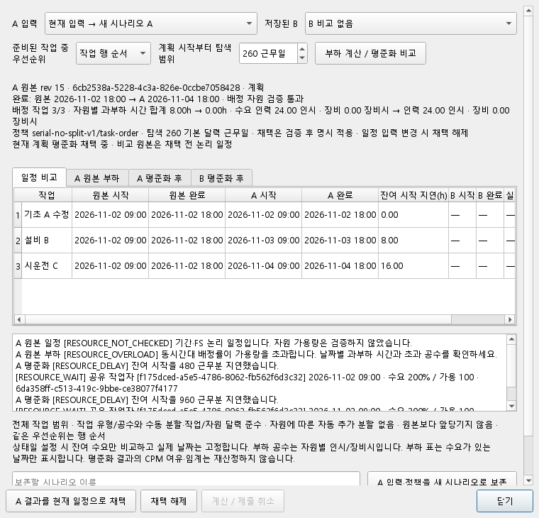
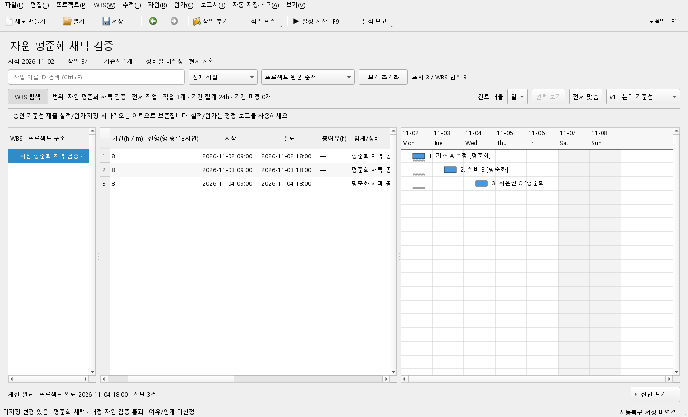

# GAP-06 평준화 채택 로컬 검증

2026-11-03 [채택 계약](../../leveling-adoption.md)의 Windows Release / Qt 6.8.3 / MinGW GCC 13.1.0 로컬 결과다. 전체 **CTest 73개 통과, 실패 0개, 303.03초**다. [원시 요약](full-ctest.log), [전체 시험 출력](ctest-details.log), [빌드 로그](build.log)를 보존한다.

| 검사 | 결과 |
|---|---|
| 채택 계약·화면 | 계획/잔여 채택·해제·undo/redo, 입력 변경/일괄 관계·공수 유형 전환의 해제, 실제 날짜/기간 실적 보존, 같은 ID 재열기에서 채택/해제 차단, 취소·읽기 전용, schema12·복구 통과 |
| 독립 채택 출력 | XLSX 2개와 PDF 2개(일정 11쪽 / Usage 10쪽), A/B/C 날짜 11-02/03/04, 계획 원가 40 / 동결 기준선 24, 사유·정책·출처와 여유/임계 미산정, 자원 미검증 진단 제거 확인 |
| 기존 독립 출력 | 기존 보고서 XLSX 5개/PDF 6개와 Usage·분류·잔여 여유·기간 실적 검사 통과 |
| 파서 | schema1~12의 정상/손상 seed 90개, 알 수 없는 채택 정책/필드 거절 확인 |
| 품질 | clang-format 18.1.8의 99개 파일 검사, 변경 없음 · diff whitespace·변경 문서 링크 검사 통과 |

[기계 판독 기록](verification.json), [소스 식별](source-identity.json), [독립 채택 출력 검사](independent-leveling-exports.json), [파서 실행 출력](parser-seed-replay.log), [포맷 검사](format-check.json), [문서 링크](markdown-links.json)를 참조한다. 소스 SHA-256은 `67596ecb30c43fdb2284f854035a88fb3f2b9954de5df05d2ae0da8082a6e038`이며 빌드에 포함된 값과 일치한다. 레시피는 src의 cpp/h와 CMakeLists.txt이며 tests/mm는 포함하지 않는다. 이전 검증 폴더와 해시는 수정하지 않았다.

독립 검사는 `.deps/report-verification/Scripts/python.exe scripts/verify-leveling-selection-exports.py build-forecast`와 기존 `verify-*-exports.py` / `verify-report-fixtures.py`로 재현한다. 앱 실행에는 Python이 필요 없다. 출력은 테스트가 `build-forecast/leveling-selection-qa`에 생성한다.

## 화면 확인

Qt offscreen 자동 시험의 한글 화면을 직접 확인했다. 작은 창의 하단 채택·해제·취소·닫기 버튼, 3일로 배치한 날짜, 미산정 여유와 채택 상태를 확인했다. 실제 Windows 데스크톱 조작·접근성 시험은 아니다.

## 범위와 미실행

실제 MS Project/P6는 [제한된 표준 경로·App Paths 확인](external-product-environment.json)에서 찾지 못했다. 모든 설치 위치를 조사한 것은 아니며 GAP-05 재계산/재저장은 미실행이다. 자원 CPM·고급 평준화·불변 채택 결정 원장은 후속이다. 선택 설정은 일반 계획 편집이며 기존 불변 사실 원장은 유지한다.

새 1천/1만 채택 성능 측정, macOS/Linux, CI, clang-tidy, ASan/UBSan, coverage-guided fuzzing, 실제 데스크톱/접근성 조작, 스토어 패키징/서명/제출은 이번 증거에 포함하지 않는다. seed 재생은 coverage fuzz 실행이 아니다.
