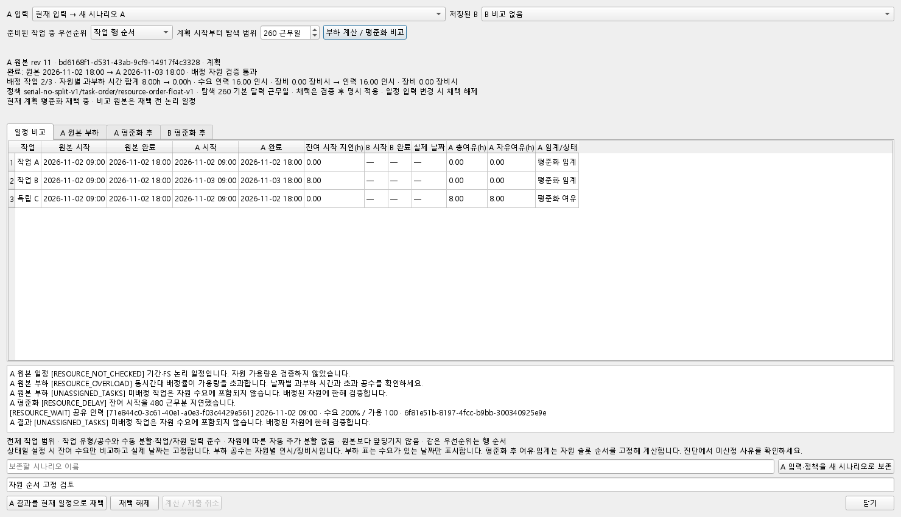
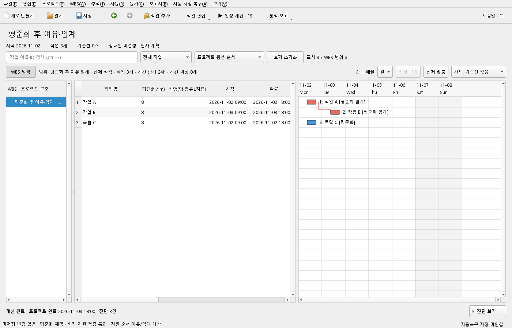

# 평준화 후 여유·임계 검증

[계산 계약](../../leveling-float.md)을 Windows / Qt 6.8.3 / MinGW GCC 13.1 Release에서 검증한다. 최종 src C++/헤더+CMake 202개 파일의 식별값은 `db589cca9e210ab015a000f8a39b5e175275299d8617c3c51b0a2d91eea242ca`다. [소스 목록](source-manifest.txt)과 [시험·스크립트·CI·바이너리 식별값](source-identity.json)을 보존한다.

## 최종 결과

- [전체 CTest 87/87 통과](ctest-windows-release.log), 294.89초. [개별 시험 상세](ctest-details.log).
- schema1..14의 파서 seed 114개 통과. [clang-format 18.1.8 검사](format-gate.json) 141개 파일 통과.
- 새 계산 및 기존 native/XML/XER/XLSX/PDF의 독립 판독·자체시험 14종 통과. [산출물 해시 목록](evidence-manifest.json).

새 [XLSX](report.xlsx)·[보고서 PDF](report.pdf)·[일정 인쇄 PDF](print.pdf)를 보존한다. 기존 기능의 독립 검사: [평준화 채택](verify-leveling-selection-exports.json), [진척+평준화](verify-progress-leveling.json), [진척 채택](verify-progress-policy-adoption.json), [기간 실적](verify-period-actual-exports.json), [Usage](verify-usage-exports.json), [분류](verify-classification-exports.json), [예측 여유](verify-forecast-float-exports.json), [인쇄](verify-schedule-print.json), [일반 보고서](verify-report-fixtures.log), [Project XML](verify-project-xml.log), [Primavera XER](verify-primavera-xer.log), [다중 XER 선택](verify-xer-project-selection.json), [P6 비교기 자체시험·MPXJ 계획 읽기](verify-p6-roundtrip.json). 실제 P6 실행은 미실행이다.

## 계산 의미와 수기 예제

현재 배치의 자원 슬롯 흐름을 FIFO로 분해해 순서를 고정한 여유다. 자원 순서를 바꾸는 재최적화나 모든 선점/교차 배치의 전역 최대 여유는 아니다. 달력 비근무 구간·수동 중단을 포함한 잔여 시작~완료 전체 구간의 배정률을 예약한다. 지원하지 않는 교차 분할은 기존 평준화 날짜를 유지하고 미산정 사유를 표시한다.

독립 A/B/C는 각각 8시간, 프로젝트 시작은 2026-11-02다. A/B만 가용량 100%의 공유 인력에 100%씩 배정한다. 행 순서 평준화 후 A는 월요일, B는 화요일, C는 월요일이다. 자원 A→B는 별도 FS driving 관계다. 완료일은 화요일 18시, A/B의 총·자유여유는 각각 0, C는 각각 8시간이다. 날짜·공수와 계획 예산 960을 유지한다. [독립 판독 결과](verify-leveling-float.json)는 openpyxl/pypdf로 이 값과 XLSX/PDF·인쇄의 출처를 대조한다.

## 요구사항 연결

| 항목 | 검사 범위 | 시험 |
|---|---|---|
| LEVEL-FLOAT-01 | 4개 native 프로필, 병렬 슬롯, 가용량 감소 fence, 달력의 밤 경계 driving, SF/자원 순환과 후진 수렴 | leveling_float_contract |
| LEVEL-FLOAT-02 | 실제 시작/완료 고정, 진척 B 활성 관계, 잔여 공수·중단과 교차 분할 미산정, 날짜/원본 불변 | leveling_float_contract, progress_leveling_contract |
| LEVEL-FLOAT-03 | 표의 여유/임계, 총·자유여유 tooltip, 간트 자원 연결, 네트워크 driving 탐색, 비교 3개 열, 보고서·인쇄 | leveling_float_ui, network_diagram_contract, 기존 UI 회귀 및 독립 reader |
| LEVEL-FLOAT-04 | 새1.1/기존1.0 기준선 재검산, native 저장/재열기, 해제/Undo·취소, legacy 시나리오 경계 정책 보존 | leveling_float_contract, milestone_baseline_regressions |

자원 용량이 충분한 경우 PDM/제약/공수의 FS·SS·FF·SF와 ±120분 지연 24개 조합에서 날짜·총여유·자유여유·임계가 기존 논리 CPM과 일치하는지도 검사한다. 한도는 작업 10,000개·관계 250,000개·후진 판정 2,000,000회다.

## 재현과 독립 검증

Qt와 MinGW의 DLL 경로를 PATH에 넣고 `cmake --build build-forecast --parallel 4`, `ctest --test-dir build-forecast --output-on-failure`를 실행한다. `.deps/report-verification/Scripts/python.exe scripts/verify-leveling-float.py build-forecast`는 openpyxl 3.1.5 / pypdf 6.10.0을 사용한다. 기존 독립 판독도 같은 최종 회귀에서 생성한 산출물로 재실행한다.

`core-metrics.json`은 1천/1만 작업의 이미 평준화된 직렬 1분 작업 배치에 **새 파생 여유 계산만** 실행한 단회 관측이다. 전체 평준화 알고리즘·파일 열기·화면 표시의 성능 수치가 아니다. 정답인 999/9999개 자원 연결과 전 작업 총여유 0도 검사한다.

[최종 관측](core-metrics.json)은 1천 작업 1,133.09ms, 1만 작업 10,438.20ms다. 성능 한도 보장이나 외부 제품과의 비교 수치로 확대하지 않는다.

실제 P6 재계산 왕복은 미설치로 미실행이다. MPXJ strict 계획 읽기와 P6 비교기 합성 자체시험은 실제 제품 실행을 대신하지 않는다. 새 원격 CI 실행·다른 OS·ASan/UBSan·coverage fuzz·패키징/설치/서명·물리 프린터는 이번 로컬 기록에 포함하지 않는다. 이전 증분의 검증 폴더는 수정하지 않는다.

