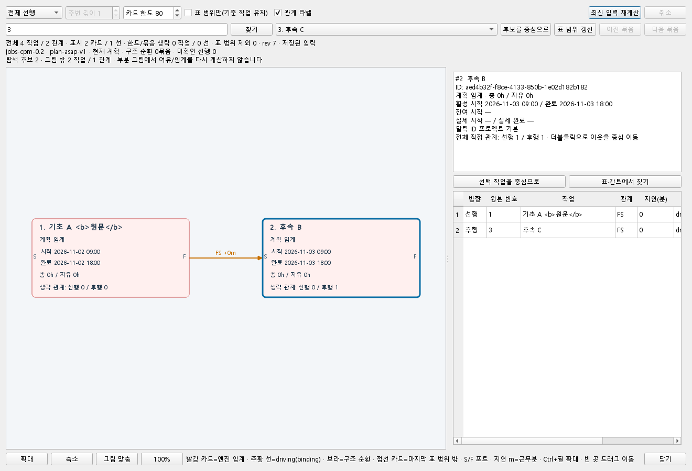
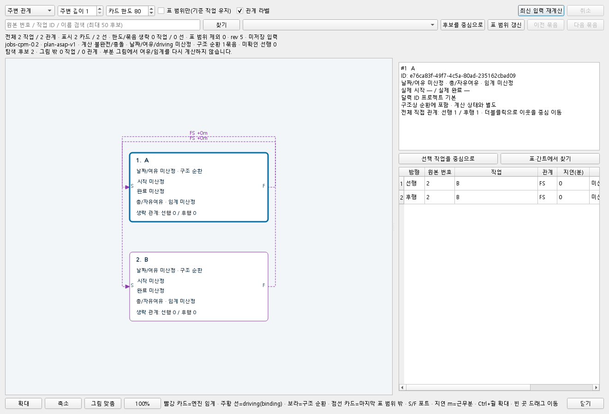
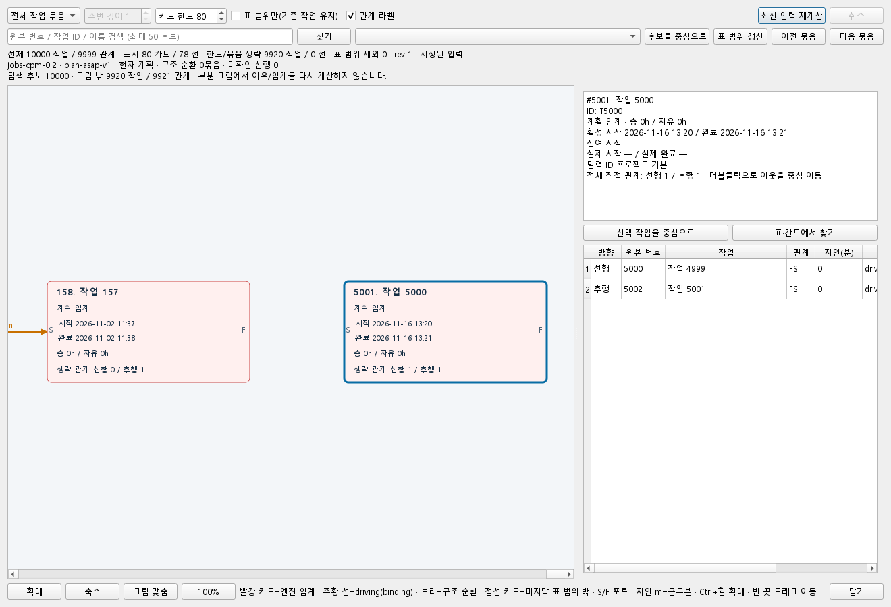

# 네트워크 다이어그램 로컬 검증

2026-11-03 [GAP-08 native 계약](../../network-diagram.md)의 Windows Release / Qt 6.8.3 / MinGW GCC 13.1.0 결과다. **전체 CTest 77개 통과, 실패 0개, 313.30초**다. [전체 로그](full-ctest.log), [시험별 출력](ctest-details.log), [제품 빌드](build.log)를 보존한다.

| 검사 | 결과 |
|---|---|
| 독립 수치 | A→B→C FS0와 독립 D 8h 사례에서 계획 완료 11-04 18:00·D 총여유 960m, A 실제 완료 반영 후 D 잔여 총여유 480m. FS/SS/FF/SF 양/음 지연 날짜를 수기 기대값과 대조 |
| 임계·driving | 전체 엔진 결과를 복사하며 부분 그림에서 재계산하지 않음. driving witness를 native 결과와 대조하고 두 FS 선행의 비 binding/binding을 별도 확인. 완료 실제와 평준화의 여유/driving 의미 유지 |
| 구조·표시 경계 | 반복형 SCC, 구조 순환과 계산 충돌 구분, 미확인 선행 경고. 30노드/870선 밀집 그래프의 5선 제한에서 생략 865선 확인. 필터 너머 가짜 직접선 생성 없음 |
| UI·보호 | 표 선택→그래프, 그래프/직접 목록 탐색→표·간트, 원본 번호 검색, HTML 문자 이스케이프, 읽기 전용·취소·편집 revision·같은 ID 재열기 session 차단, 원본/dirty 불변 |
| 대용량 | 1천/1만 체인의 주변 제한, 전체 묶음 80카드/78선/314장면 항목, 직접 목록 2행, 다음/이전 묶음과 기준 카드의 실제 viewport 내 표시 확인 |
| 품질 | clang-format 18.1.8 111파일 변경 없음, 소스/빌드 해시 일치. 기존 출력의 독립 reader 검사는 아래 기록 참조 |

[작은 사례 기록](contract.json), [순수 계산/query 측정](core-metrics.json), [UI 측정](ui-metrics.json), [포맷 검사](format-check.json), [소스 식별](source-identity.json), [시험/스크립트 해시](test-script-sha256.json), [문서 링크 검사](markdown-links.json), [기계 판독 기록](verification.json)을 남긴다. 제품 소스 SHA-256은 `d6f77915ace53882f0e7ade11bac0ed5d5cf7bd74e854b2bbb1f8b2266890851`이며 빌드 값과 일치한다. src cpp/h·CMakeLists.txt의 case-sensitive 정렬 레시피는 tests/mm/scripts를 제외하며 관련 시험/검증 스크립트는 별도 해시다. 이전 증분의 검증 폴더는 수정하지 않았다.

기존 산출물의 독립 reader 검사 7종도 모두 통과했다: [인쇄](independent-schedule-print.json), [평준화](independent-leveling-selection-exports.json), [일반 보고서](independent-report-exports.log), [Usage](independent-usage-exports.json), [분류](independent-classification-exports.json), [예측 여유](independent-forecast-float-exports.json), [기간 실적](independent-period-actual-exports.json). 전체 회귀의 파서 seed replay는 schema 1~12의 90개를 통과했다. 이 실행은 새 coverage-guided fuzz가 아니다.

## 규모 측정

고정 입력은 2026-11-02 시작, 단일 기본 달력, 작업별 1분의 단순 FS0 체인이다. Windows 로컬 offscreen의 한 번 측정이며 상한 보장·임의 그래프 성능 보장이 아니다. 복잡한 자원·제약/진척/달력·밀집 관계 1만 작업은 측정하지 않았다.

| 작업 | 순수 build ms | 순수 query ms | UI 초기 ready ms | UI 마지막 묶음 query ms | UI 마지막 묶음 render ms |
|---|---|---|---|---|---|
| 1,000 | 8.86 | 0.18 | 102 | 0.92 | 2.51 |
| 10,000 | 41.88 | 0.38 | 71 | 1.22 | 2.32 |

순수 build는 전체 계산·관계 인덱스·SCC/계층을 포함하며 query는 주변 깊이 2다. UI ready는 문서 로딩 후 창 생성부터 기본 주변 그림 완료까지이며 build와 이벤트 처리/레이아웃도 포함한다. UI query/render는 마지막 다음 묶음의 별도 관측이므로 ready 값과 합산하지 않는다. 별도 순수 전체 선행 질의에서 1천/1만 중간 작업은 후보 501/5001개, 표시 80개, 생략 421/4921개였다.

## 화면

## 범위와 재현

`ctest --test-dir build-forecast -R network_diagram --output-on-failure`로 두 시험을 실행한다. 앱 실행에 Python/Office는 필요 없다. 네트워크는 schema를 추가하지 않으며 기존 조건부 schema 9/10/11/12와 원장을 유지한다.

실제 데스크톱/접근성 조작, macOS/Linux, CI, clang-tidy, ASan/UBSan, 새 coverage-guided fuzz, 실제 MSP/P6 왕복·재계산, 배포 패키징/설치/서명은 미실행이다. 관계 편집·네트워크 인쇄/내보내기·배치 저장·조직/프로젝트 간 네트워크는 후속이며 이번 소규모/체인 측정을 전체 상용 제품 동등성으로 확대하지 않는다.
