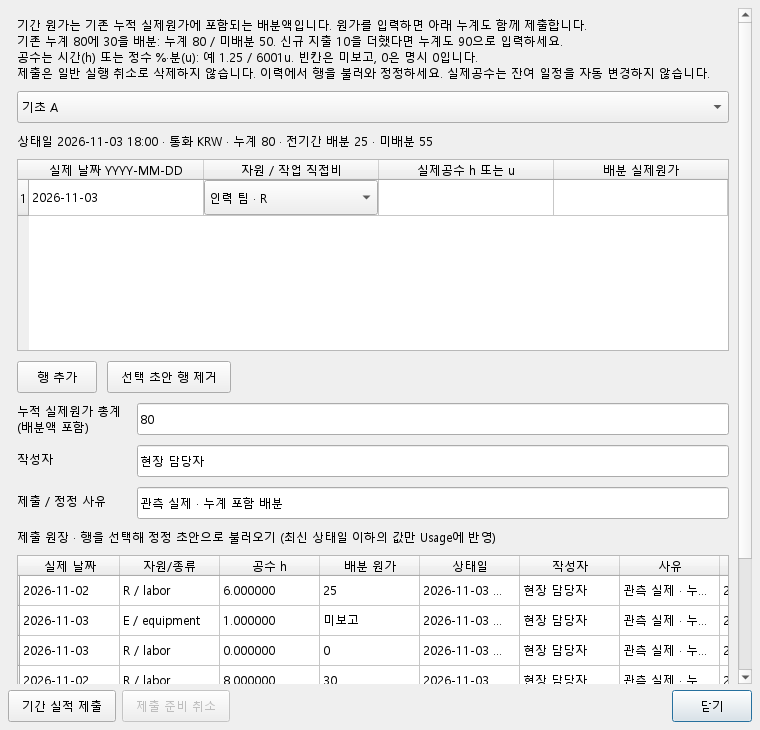
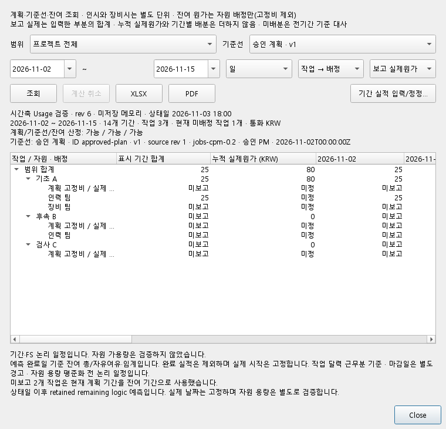

# 기간별 실제공수·실제원가 입력 검증

2026-11-03 사용자 요청에 따른 GAP-04 입력/정정 증분이다. [사용 방법·원장·누계 대사 계약](../../period-actuals.md), [PRD](../../planning/01-product-prd.md), [로드맵](../../planning/06-roadmap.md)을 연결한다. 계획 기간별 배정 편집·자동 실제 추정·외부 제품 교환 확대는 이번 범위가 아니다.

## 구현과 검사

**전체 CTest 71개 통과, 283.09초.** 새 `period_actual_contract`/`period_actual_ui`와 기존 일정·공수·추적·분류·원가·교환·파일/복구·보고서 회귀를 포함한다. Release 빌드, [독립 출력 검사](independent-export.json), [clang-format 18.1.8](format.json)도 통과했다. [전체 실행 로그](full-ctest.log)와 [검증 요약·소스/검사 파일 식별](verification.json)을 보존한다.

schema 1~11의 정상/거절 입력을 포함한 [80개 parser seed 재생](parser-seed-replay.log)을 통과했다. 이는 coverage-guided fuzzing 실행과 구분한다.

- `(작업 ID, 자원 ID, 실제 날짜)` 키의 불변 관측 원장을 추가했다. 작성자/사유·UTC·상태일·원본 문서/revision·이전 보고·원가 누계 보고 ID를 보존한다. 자원 종류는 입력 시 동결하고 정정에서 원래 단위를 유지한다.
- 시간 또는 정수 `%·분` 접미사 `u`로 공수를 입력한다. 원가/공수의 미보고와 명시 0을 구분하고 전체 행을 한 원자적 worker 제출로 처리한다. 실패/취소/문서 교체는 부분 반영하지 않는다.
- 누계 AC를 기간별 배분에 다시 더하지 않는다. 원가 배분 제출은 포함 누계를 함께 기록하고 EV 물리 진척은 유지한다. 원가 정정은 기존 기록을 삭제하거나 차액을 누적하지 않고 최신 스냅샷을 선택한다.
- 현재뿐 아니라 모든 과거 보고 상태일의 배분≤누계 관계를 검증한다. 과거 정정 때문에 이후 누계와 모순되는 제출도 거절한다. 날짜 범위를 좁혀도 전기간 배분/미배분은 유지한다.
- 자원 메뉴·Usage 입력 버튼·정정 원장·보고 실제공수/원가·XLSX/PDF를 연결했다. 원장은 가상 표, 자원 선택 목록은 공유 모델을 사용한다. 작은 화면에서 제출/취소/닫기를 고정 footer에 두고 오류는 스크롤해서 볼 수 있게 했다.
- 원장이 있으면 schema 11, 없으면 기존 schema 9/10 writer를 유지한다. 저장/사본/실제 복구 checkpoint에 이력과 누계 링크를 보존하고 삭제/통화 변경·읽기 전용을 보호한다. XML/XER는 명시 손실과 전체 native 사본으로 처리한다.

| 검사 | 확인 내용 |
|---|---|
| 입력·정밀도 | 두 자원 종류·작업 직접비, `0.0055h=33 %·분`, `6001u`, 6자리 초과/분수 단위/음수/지수 표기 거절, 명시 0과 미보고 |
| 원장·원자성 | 다중 행 원자적 적용, 중복 키·미래 날짜·자원 없는 공수·누계 누락·음수 미배분 거절, 실패 뒤 문서/revision 불변 |
| 정정·상태일 | 같은 상태일 최신 정정, 더 과거 상태일로 이동, 미래 정정의 미반영, 철회(null)·명시 0, 과거 정정과 미래 누계 충돌 거절 |
| 누계·계획 | AC 한 번만 합산, 물리 EV 보존, 계획/예측 날짜·불변 기준선 유지, 전기간 배분과 미배분 대사 |
| 참조·단위 | 작업 삭제·자원 삭제·통화 변경 보호, 배정 해제 후 정정, 자원 종류를 바꿔도 기존 관측 단위 유지 |
| 저장·복구 | schema 11 roundtrip, 사본의 원래 출처, 실제 recovery checkpoint/scan/claim/recover, 알 수 없는 원장 필드·소수 정수 필드 거절 |
| worker·읽기 전용 | 준비 중 입력 불변, 적용 뒤 dirty/불변 이력 경계, 계획 undo/redo의 사실 보존, 취소, 같은 ID/revision의 새 session에서 오래된 결과 거절 |
| UI | 실제 메뉴·다중 행·누계 초깃값·이력 불러오기·정정·오류·취소·읽기 전용, 고정 footer, Usage 보고 합계와 건수·누계 |
| 보고·안전성 | Usage와 일반 보고서의 기간 명세/전기간 대사/전체 이력, 독립 XLSX/PDF, 보고 합계 한도 초과의 미정이 이후 값으로 되살아나지 않음 |

## 독립 수치와 출력

계산 계약 테스트의 첫 제출은 인력 8인시/30, 장비 1장비시/10, 작업 직접비 5와 포함 누계 80이다. 알려진 배분 45·미배분 35이며 EVM AC는 80이다. 이후 인력 값을 6인시/25로 정정하면 배분 40·미배분 40이며 원본 8인시/30은 이력에 남는다.

별도의 실제 UI 흐름은 인력 8인시/30 → 인력의 다른 날짜 명시 0/0 → 장비 1장비시/원가 미보고 → 첫 인력을 6인시/25로 정정한다. 최종 유효 키는 3개, 전체 이력은 4개다.

| UI/출력 기대값 | 값 |
|---|---|
| 보고 인력 공수 | 6인시 (0 보고 포함) |
| 보고 장비 공수 | 1장비시 |
| 알려진 원가 배분 | 25 (원가 미보고를 실제 0으로 확정하지 않음) |
| 누계 AC | 80 |
| 전기간 미배분 | 55 |
| 공수/원가 유효 보고 | 3건 / 2건 |
| 정정 이력 | 원본 8인시/30과 최신 6인시/25가 서로 다른 ID로 연결 |

openpyxl은 최신 3행·전체 4행, 숫자형 0·미보고 문자열, 자원 단위별 공수, `80=25+55`, 작성자/사유·원본/이전/누계 ID, 수식·외부 링크·VBA 부재를 대조했다. pypdf는 8페이지의 한국어 명세·대사·이력·작성자·문서 ID와 제어문자 부재를 확인했다. PDF 텍스트 검사는 페이지 렌더링 시각 QA를 대신하지 않는다.

기존 [Usage 출력](usage-export.json), [분류 출력](classification-export.json), [예측 여유 출력](forecast-export.json)과 [XLSX 5개/PDF 6개 보고 fixture](existing-report-exports.log)도 최종 빌드로 독립 재검사를 통과했다.



입력 화면은 누계 80·배분 25·미배분 55와 원본/정정 이력을 표시한다. 760px offscreen 창에서도 제출/취소/닫기는 스크롤 밖에 남는다. 원장과 초안 영역은 필요한 경우 스크롤한다.



Usage의 보고 배분 25와 누계 80을 나란히 표시한다. 배분/날짜가 없는 누계를 자원에 자동 배분하지 않는다. 해당 자원에 제출이 없으면 `미보고`이며 0 보고는 0이다. 툴팁에는 공수/원가 보고 건수와 전기간 미배분을 표시한다.

## 재현·소스 식별·한계

Qt/MinGW `bin`, CMake/Ninja를 PATH에 둔다. 기존 `build` 캐시는 옛 경로를 가리켜 `build-forecast`를 사용했다.

```powershell
cmake --build build-forecast --parallel 4
ctest --test-dir build-forecast --output-on-failure
python scripts/verify-period-actual-exports.py build-forecast
python scripts/verify-usage-exports.py build-forecast
python scripts/verify-report-fixtures.py build-forecast
```

독립 reader는 기존 선택 개발 의존성 openpyxl/pypdf를 사용한다. UI 출력은 `build-forecast/period-actual-qa`에 생성하며 테스트는 그 폴더의 지정 출력만 갱신한다. 제품 출력은 기존 파일을 덮어쓰지 않는다.

제품 소스 SHA-256은 `2a7e85820c51a236bc2446fff6402ebc84294169f58e76bd5b52a6771b4445d6`이다. 정렬한 `src/**/*.cpp`, `src/**/*.h`, `CMakeLists.txt`의 파일별 SHA-256 manifest로 계산하며 BuildIdentity.h와 대조한다. Git 기준은 `6a1cd0a5115f3400d6cee4e5d5df795f351195ea + dirty`다. 앞선 검증 폴더는 당시의 기록을 유지하고 새 커밋·CI·배포를 만들지 않았다.

- 검증 플랫폼은 Windows·MinGW GCC 13.1·Qt 6.8.3·Release이며 화면은 Qt offscreen·Windows 맑은 고딕이다. 실제 데스크톱/접근성·macOS/Linux·CI·ASan/UBSan·coverage-guided fuzzing·실제 MSP/P6 왕복은 이번 증분에서 실행하지 않았다.
- 새 규모/메모리 벤치마크나 50,000기록 UI 부하 측정은 수행하지 않았다. 기록/파일/셀 한도는 처리량 보장이 아니다. 기존 1천/1만 Usage 조회 회귀는 기간 실적 없는 fixture의 범위를 따른다.
- 실제 소요 기간·잔여 작업량·미래 일정은 별도 진척 보고다. 관측 실제공수로 자동 차감/추정하거나 단가로 실제원가를 재평가하지 않는다. 배분에 포함할 누계는 사용자가 명시한다.
- 계획 기간별 배정 편집·실제 시간 구간(시각)/초과근무별 구분·자동 누계 배분·타임시트 승인/권한·회계 연계·외부 교환 매핑은 후속이다.
