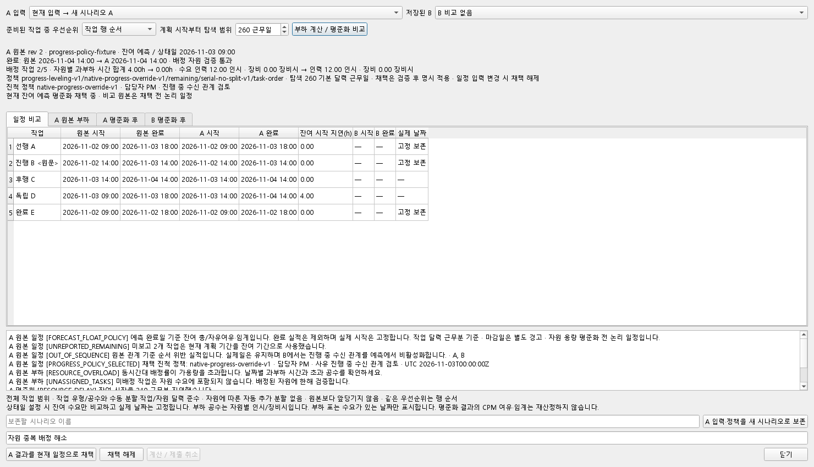
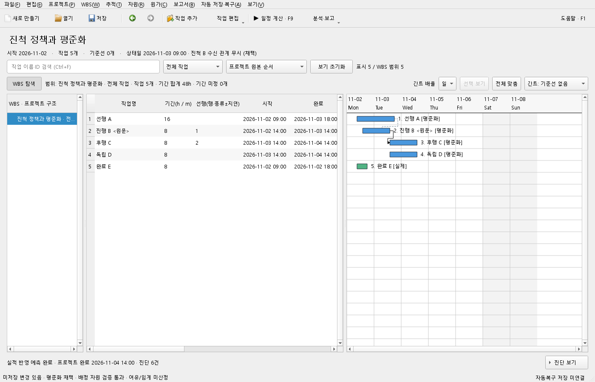

# 진척 정책+평준화 검증

> 당시 원시 자료·화면·로그는 [고정 원본](https://github.com/jhoon-dev/ProjectPlanningManager/tree/77bb5a1cead1cb2c47f36e57b00d478746f32434/docs/validation/progress-leveling-2026-11-03)에 보존되어 있습니다. 새 실행 결과는 CI 산출물로 보관합니다.

[기능·저장 계약](../../progress-policy-leveling.md)을 Windows / Qt 6.8.3 / MinGW GCC 13.1 Release에서 검증한다. 최종 src C++/헤더+CMake 200개 파일의 식별값은 `7a4646677ba514ead48c2a53b92ec0eb8f92cc91dc69385f9d956803091177cf`다. [전체 목록](https://github.com/jhoon-dev/ProjectPlanningManager/blob/77bb5a1cead1cb2c47f36e57b00d478746f32434/docs/validation/progress-leveling-2026-11-03/source-manifest.txt)과 [테스트·스크립트/빌드 식별값](https://github.com/jhoon-dev/ProjectPlanningManager/blob/77bb5a1cead1cb2c47f36e57b00d478746f32434/docs/validation/progress-leveling-2026-11-03/source-identity.json)을 보존한다.

## 최종 결과

- [전체 CTest 85/85 통과](https://github.com/jhoon-dev/ProjectPlanningManager/blob/77bb5a1cead1cb2c47f36e57b00d478746f32434/docs/validation/progress-leveling-2026-11-03/ctest-windows-release.log), 271.90초. [개별 시험 상세](https://github.com/jhoon-dev/ProjectPlanningManager/blob/77bb5a1cead1cb2c47f36e57b00d478746f32434/docs/validation/progress-leveling-2026-11-03/ctest-details.log).
- schema1..14의 파서 seed 114개 통과, [clang-format 18.1.8 검사](https://github.com/jhoon-dev/ProjectPlanningManager/blob/77bb5a1cead1cb2c47f36e57b00d478746f32434/docs/validation/progress-leveling-2026-11-03/format-gate.json) 136개 파일 통과.
- [새 조합 독립 판독](https://github.com/jhoon-dev/ProjectPlanningManager/blob/77bb5a1cead1cb2c47f36e57b00d478746f32434/docs/validation/progress-leveling-2026-11-03/independent-reader.json)과 기존 native/XML/XER/XLSX/PDF 판독 기록을 보존한다. P6 자체시험은 실제 P6 실행과 구분한다.

## 검증 연결

| 항목 | 범위 | 검사 |
|---|---|---|
| PROGRESS-LEVELING-01 | FS0/PDM/제약/공수 엔진, FS/SS/FF/SF·양음 lag, 준비 순서와 날짜 경계의 B 관계 마스크, 실제일 보존, 고정 공수·중단, 미정 용량/탐색 실패/필수 제약/원본 순환 거절, 여유·임계 미산정 | progress_leveling_contract |
| PROGRESS-LEVELING-02 | worker 준비/반영, 입력·상태일 수정 시 무효화, 정책 변경/해제와 평준화 해제의 원자적 Undo/Redo, 취소·stale·읽기 전용 | contract / ui 및 기존 편집 회귀 |
| PROGRESS-LEVELING-03 | schema14, 조합/시나리오 정책의 구버전 거절, 저장/재열기/SaveAs/복구, 현재 정책 해제 후 동결 시나리오 재생, 비활성 정책+계획 평준화 | contract, parser_seed_replay |
| PROGRESS-LEVELING-04 | 비교·채택·시나리오 저장·정책 변경 UI, 표/간트/네트워크/잔여 Usage/유효 단가·보고서/인쇄, 두 채택의 근거 | ui, core 및 독립 reader |

## 수기 예제

상태일은 2026-11-03 09:00이다. 진행 중 B의 원본 선행 A는 그대로 두되 B 정책의 예측 수신 관계는 비활성화한다. B의 실제 시작 11-02 14:00과 완료 작업 E의 실제일은 고정한다. B와 미착수 D가 100% 공유 인력 한 명을 사용한다.

- B 잔여 4시간은 화요일 09:00~14:00이다. 평준화가 비활성 A→B를 복구하여 B를 수요일로 밀지 않아야 한다.
- D 잔여 8시간은 평준화 전 화요일 09:00~18:00, 평준화 후 화요일 14:00~수요일 14:00이다. 4시간의 과부하가 사라진다. B→C의 미착수 수신 관계는 유지한다.
- 단가는 수요일부터 60→120이다. B 잔여 원가 240, D 잔여 원가 240+480=720, 배정 잔여 합계 12시간/960이다. 원본 계획 원가 1,440은 유지한다. 기준선 동결/계획 불변은 별도의 core fixture에서 검증한다.
- 평준화 후 총/자유여유·임계·driving은 미산정이다. 평준화 전 A/B 비교는 계속 논리 일정끼리 비교한다.

## 산출물과 재현

`cmake --build build-forecast --parallel 4`, `ctest --test-dir build-forecast --output-on-failure`로 재현한다. Qt/MinGW DLL 경로가 PATH에 있어야 한다. `.deps/report-verification/Scripts/python.exe scripts/verify-progress-leveling.py build-forecast`는 openpyxl 3.1.5/pypdf 6.10.0으로 native checksum·schema14·원본 관계, XLSX/PDF 날짜·공수/원가·미산정·두 채택 근거와 인쇄를 독립 판독한다.

실제 P6 재계산 왕복은 미설치로 미실행이다. P6 비교기 자체시험과 MPXJ 계획 읽기는 실제 P6 실행의 증거가 아니다. 새 ASan/UBSan·coverage fuzz·패키징/설치/서명·원격 CI·macOS/Linux 실행은 이 기록의 범위에 포함하지 않는다. 이전 증분의 검증 폴더는 수정하지 않는다.

[조합 native 원본](https://github.com/jhoon-dev/ProjectPlanningManager/blob/77bb5a1cead1cb2c47f36e57b00d478746f32434/docs/validation/progress-leveling-2026-11-03/combined.ppm) · [일반 보고서 XLSX](https://github.com/jhoon-dev/ProjectPlanningManager/blob/77bb5a1cead1cb2c47f36e57b00d478746f32434/docs/validation/progress-leveling-2026-11-03/schedule.xlsx)/[PDF](https://github.com/jhoon-dev/ProjectPlanningManager/blob/77bb5a1cead1cb2c47f36e57b00d478746f32434/docs/validation/progress-leveling-2026-11-03/schedule.pdf) · [Usage XLSX](https://github.com/jhoon-dev/ProjectPlanningManager/blob/77bb5a1cead1cb2c47f36e57b00d478746f32434/docs/validation/progress-leveling-2026-11-03/usage.xlsx)/[PDF](https://github.com/jhoon-dev/ProjectPlanningManager/blob/77bb5a1cead1cb2c47f36e57b00d478746f32434/docs/validation/progress-leveling-2026-11-03/usage.pdf) · [일정 인쇄 PDF](https://github.com/jhoon-dev/ProjectPlanningManager/blob/77bb5a1cead1cb2c47f36e57b00d478746f32434/docs/validation/progress-leveling-2026-11-03/print.pdf)

