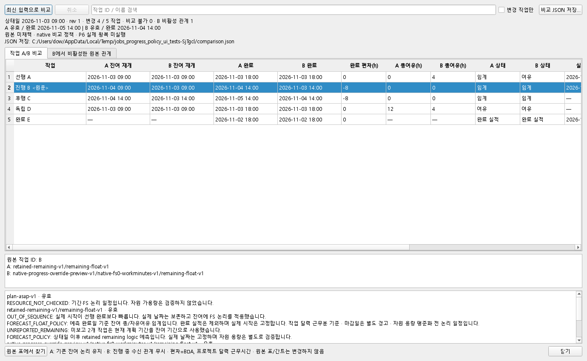
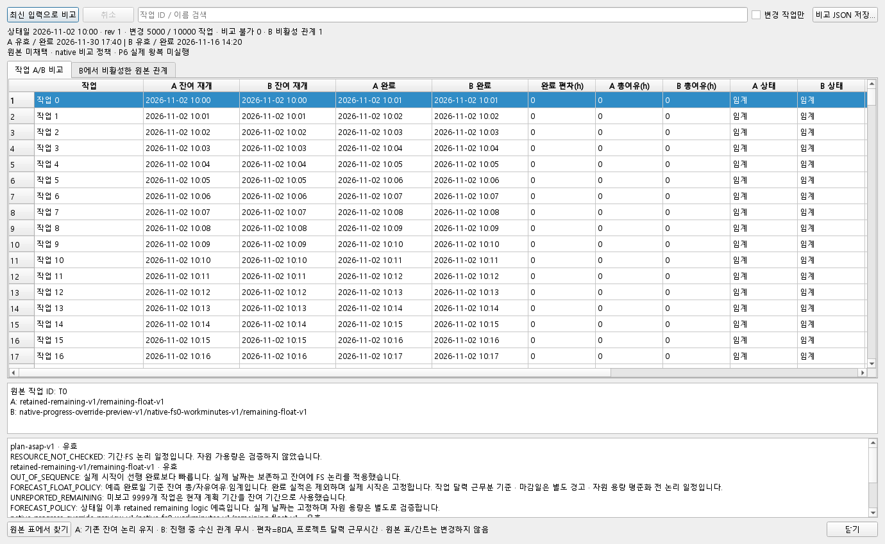

# 진척 정책 비교 및 P6 준비 로컬 검증

> 당시 원시 자료·화면·로그는 [고정 원본](https://github.com/jhoon-dev/ProjectPlanningManager/tree/77bb5a1cead1cb2c47f36e57b00d478746f32434/docs/validation/progress-policy-2026-11-03)에 보존되어 있습니다. 새 실행 결과는 CI 산출물로 보관합니다.

2026-11-03 [GAP-10 첫 증분](../../progress-policy-comparison.md)의 Windows / Qt 6.8.3 / MinGW GCC 13.1.0 / Release 결과다. **전체 CTest 81개 통과, 실패 0개, 276.51초**다. [빌드](https://github.com/jhoon-dev/ProjectPlanningManager/blob/77bb5a1cead1cb2c47f36e57b00d478746f32434/docs/validation/progress-policy-2026-11-03/build.log), [전체 CTest](https://github.com/jhoon-dev/ProjectPlanningManager/blob/77bb5a1cead1cb2c47f36e57b00d478746f32434/docs/validation/progress-policy-2026-11-03/full-ctest.log), [시험별 출력](https://github.com/jhoon-dev/ProjectPlanningManager/blob/77bb5a1cead1cb2c47f36e57b00d478746f32434/docs/validation/progress-policy-2026-11-03/ctest-details.log)을 보존한다.

**사용자가 P6 미설치를 확인했으므로 실제 P6 실행·왕복은 미실행이다.** [실행 상태](https://github.com/jhoon-dev/ProjectPlanningManager/blob/77bb5a1cead1cb2c47f36e57b00d478746f32434/docs/validation/progress-policy-2026-11-03/p6-execution-status.json)와 [설치 후 절차](../../p6-roundtrip.md)를 참조한다. 새 비교기 자체시험·native 수치·MPXJ 성공을 P6 실제 실행으로 표시하지 않는다.

| 검사 | 결과 |
|---|---|
| 수기 날짜/여유 | A 잔여 8h·B 잔여 4h·B→C 8h 사례. A정책 B 완료 11-04 14:00 / C 11-05 14:00, B정책 B 11-03 14:00 / C 11-04 14:00. C 완료 편차 −480 프로젝트 근무분. B정책 A/D 총여유 240분, B/C 임계 |
| 고정 사실 | B 실제 시작 11-02 14:00과 E 실제 완료 11-02 18:00 유지. 완료 E의 미래 여유/임계는 JSON null. 원본/기준선·dirty/일반 계산 불변 |
| 계산 범위 | FS0/PDM/제약/공수 4개 프로필, FS/SS/FF/SF 각 ±60분·잔여 Fixed Work·수동 중단·작업 달력 휴일·A 충돌/B 유효·미보고 관계 유지 확인 |
| 그래프/설명 | 원본 전체 계획의 순환/오류·상태일 없음·채택 평준화 차단. 수신 관계 비활성은 전진/후진/여유/driving에 공통 적용. 원본 계획 참조와 순서 위반 진단 보존 |
| 화면/출력 | 가상 표·변경/ID 검색·안정 ID 원본 이동·JSON 원시 날짜/근무분/비활성 관계. native 비교와 미채택/P6 미실행 표시. 취소·편집/undo·같은 ID 재열기·읽기 전용·파일 선택 중 변경/기존 파일 보존 확인 |
| 규모 | 1천/1만 1분 FS0 체인·가운데 한 작업 실제 시작, 동일 snapshot A/B 계산과 1천/1만 가상 행 표시. 아래 단일 관측 참조 |
| 품질 | 포맷 126 C++ 파일 변경 없음, 소스/빌드 SHA 일치. source SHA는 `33965af33cfef95d4e9fc07829298bb3cea2db64f903871c97a78ebfdd3d4575` |

초기 검사에서 테스트 기준선의 id/version/revision 메타데이터가 부족해 원본 검증이 차단됐고 이를 정상적인 승인 snapshot으로 보완했다. PDM 내부 경과분을 표시 편차로 사용한 문제를 발견해 명시한 프로젝트 달력 근무분으로 수정했다. 파일 선택 시험의 동기 accept가 덮어쓰기 확인에서 timer 재진입을 막는 문제는 queued 호출로 수정했다. 수정 후 위 검증을 수행했다. 통합 회귀 중 Save As의 ID/session 무효화 보완이 필요해 [초기 실행](https://github.com/jhoon-dev/ProjectPlanningManager/blob/77bb5a1cead1cb2c47f36e57b00d478746f32434/docs/validation/progress-policy-2026-11-03/initial-before-save-as-ctest.log)을 중단하고 회귀를 추가한 뒤 위 전체 81개를 다시 실행했다.

[비교 JSON](https://github.com/jhoon-dev/ProjectPlanningManager/blob/77bb5a1cead1cb2c47f36e57b00d478746f32434/docs/validation/progress-policy-2026-11-03/comparison.json), [UI 내보내기](https://github.com/jhoon-dev/ProjectPlanningManager/blob/77bb5a1cead1cb2c47f36e57b00d478746f32434/docs/validation/progress-policy-2026-11-03/ui-comparison.json), [순수 비교 관측](https://github.com/jhoon-dev/ProjectPlanningManager/blob/77bb5a1cead1cb2c47f36e57b00d478746f32434/docs/validation/progress-policy-2026-11-03/core-metrics.json), [UI 관측](https://github.com/jhoon-dev/ProjectPlanningManager/blob/77bb5a1cead1cb2c47f36e57b00d478746f32434/docs/validation/progress-policy-2026-11-03/ui-metrics.json), [소스 식별](https://github.com/jhoon-dev/ProjectPlanningManager/blob/77bb5a1cead1cb2c47f36e57b00d478746f32434/docs/validation/progress-policy-2026-11-03/source-identity.json), [시험/스크립트/CI 해시](https://github.com/jhoon-dev/ProjectPlanningManager/blob/77bb5a1cead1cb2c47f36e57b00d478746f32434/docs/validation/progress-policy-2026-11-03/test-script-sha256.json), [포맷](https://github.com/jhoon-dev/ProjectPlanningManager/blob/77bb5a1cead1cb2c47f36e57b00d478746f32434/docs/validation/progress-policy-2026-11-03/format-check.json), [문서 링크](https://github.com/jhoon-dev/ProjectPlanningManager/blob/77bb5a1cead1cb2c47f36e57b00d478746f32434/docs/validation/progress-policy-2026-11-03/markdown-links.json), [기계 판독 기록](https://github.com/jhoon-dev/ProjectPlanningManager/blob/77bb5a1cead1cb2c47f36e57b00d478746f32434/docs/validation/progress-policy-2026-11-03/verification.json)을 남긴다. 이전 증분 검증 폴더는 수정하지 않았다. 소스 식별은 case-sensitive 정렬된 src cpp/h·CMakeLists.txt이며 tests/mm/scripts/CI는 별도 해시다.

기존 독립 검사 9종도 통과했다: [다중 XER](https://github.com/jhoon-dev/ProjectPlanningManager/blob/77bb5a1cead1cb2c47f36e57b00d478746f32434/docs/validation/progress-policy-2026-11-03/independent-selection.json), [기존 XER TSV/MPXJ](https://github.com/jhoon-dev/ProjectPlanningManager/blob/77bb5a1cead1cb2c47f36e57b00d478746f32434/docs/validation/progress-policy-2026-11-03/independent-legacy-xer.log), [인쇄](https://github.com/jhoon-dev/ProjectPlanningManager/blob/77bb5a1cead1cb2c47f36e57b00d478746f32434/docs/validation/progress-policy-2026-11-03/independent-schedule-print.json), [평준화](https://github.com/jhoon-dev/ProjectPlanningManager/blob/77bb5a1cead1cb2c47f36e57b00d478746f32434/docs/validation/progress-policy-2026-11-03/independent-leveling-selection-exports.json), [일반 보고서](https://github.com/jhoon-dev/ProjectPlanningManager/blob/77bb5a1cead1cb2c47f36e57b00d478746f32434/docs/validation/progress-policy-2026-11-03/independent-report-exports.log), [Usage](https://github.com/jhoon-dev/ProjectPlanningManager/blob/77bb5a1cead1cb2c47f36e57b00d478746f32434/docs/validation/progress-policy-2026-11-03/independent-usage-exports.json), [분류](https://github.com/jhoon-dev/ProjectPlanningManager/blob/77bb5a1cead1cb2c47f36e57b00d478746f32434/docs/validation/progress-policy-2026-11-03/independent-classification-exports.json), [예측 여유](https://github.com/jhoon-dev/ProjectPlanningManager/blob/77bb5a1cead1cb2c47f36e57b00d478746f32434/docs/validation/progress-policy-2026-11-03/independent-forecast-float-exports.json), [기간 실적](https://github.com/jhoon-dev/ProjectPlanningManager/blob/77bb5a1cead1cb2c47f36e57b00d478746f32434/docs/validation/progress-policy-2026-11-03/independent-period-actual-exports.json). 파서 seed replay 92개도 통과했다.

## 규모 관측

입력은 2026-11-02 09:00 시작·상태일 10:00, 작업마다 1분의 FS0 체인이다. 가운데 한 작업만 09:00 실제 시작/잔여 1분을 보고한다. 배정·복잡한 제약/달력·대량 실적 원장은 없다. 순수 비교는 원본 계획 검증과 두 정책 전체 계산을 포함하며 UI ready는 문서 로딩 후 창 생성부터 표 모델 준비까지다. worker/render 값을 ready와 합산하지 않는다. 단일 Windows offscreen 관측이며 고정 응답시간이나 모든 입력 성능을 보장하지 않는다.

| 작업 | 순수 비교 ms | UI ready ms | UI worker ms | UI 모델/표 준비 ms |
|---|---|---|---|---|
| 1,000 | 56.31 | 173 | 60.02 | 3.67 |
| 10,000 | 544.41 | 655 | 579.28 | 6.57 |

## 화면

## P6 실행 준비와 경계

[계획 XER](https://github.com/jhoon-dev/ProjectPlanningManager/blob/77bb5a1cead1cb2c47f36e57b00d478746f32434/docs/validation/progress-policy-2026-11-03/p6-kit/plan-input.xer), [예상 계획/해시](https://github.com/jhoon-dev/ProjectPlanningManager/blob/77bb5a1cead1cb2c47f36e57b00d478746f32434/docs/validation/progress-policy-2026-11-03/p6-kit/expected-plan.json), [실제/잔여 native 원본](https://github.com/jhoon-dev/ProjectPlanningManager/blob/77bb5a1cead1cb2c47f36e57b00d478746f32434/docs/validation/progress-policy-2026-11-03/p6-kit/progress-native.ppm), [native 정책 수치](https://github.com/jhoon-dev/ProjectPlanningManager/blob/77bb5a1cead1cb2c47f36e57b00d478746f32434/docs/validation/progress-policy-2026-11-03/p6-kit/expected-native-comparison.json)를 제공한다. 계획 파일에는 진척 실적을 넣지 않는다. 진척 정책은 P6에서 실제/잔여를 별도로 입력하는 시험이다.

`python scripts/verify-p6-roundtrip.py --self-test`는 합성 반환 행의 일치/차이/미정·중복/비유한 수치와 원본 XER의 미재계산 날짜를 검사한다. `--mpxj-reopen`은 준비 파일의 지원 계획 부분만 독립 reader로 확인한다. [자체시험/독립 reader 결과](https://github.com/jhoon-dev/ProjectPlanningManager/blob/77bb5a1cead1cb2c47f36e57b00d478746f32434/docs/validation/progress-policy-2026-11-03/p6-comparator-selftest.json)는 실제 P6 실행을 입증하지 않는다. 반환 파일이 생기면 [절차](../../p6-roundtrip.md)에 따라 제품/버전·설정·실행 화면/로그·입출력 해시를 별도로 남긴다.

## 재현과 미실행

`ctest --test-dir build-forecast -R progress_policy --output-on-failure`로 두 회귀와 준비 파일 생성을 실행한다. JSON 저장은 기존 파일을 원자적으로 교체하며 취소/stale에서는 게시 전 보존한다. UI 진단은 정책별 500개까지만 표시하며 JSON에는 전체 원인/관련 대상과 진단을 기록한다.

실제 P6/MSP 재계산/재저장 왕복, 실제 데스크톱/접근성·macOS/Linux·CI 실행, 새 ASan/UBSan/clang-tidy/coverage-guided fuzz, 패키징/설치/서명은 미실행이다. native 정책 채택·영속 정책 저장·일반 간트/Usage/EVM 적용과 P6 Actual Dates/Steps/LOE는 후속이다. native schema 1~12 및 조건부 9/10/11/12 쓰기는 유지한다. CI에는 새 자체시험/reader와 산출물 업로드를 추가했으며 이 세션에서 실행하지 않았다.
