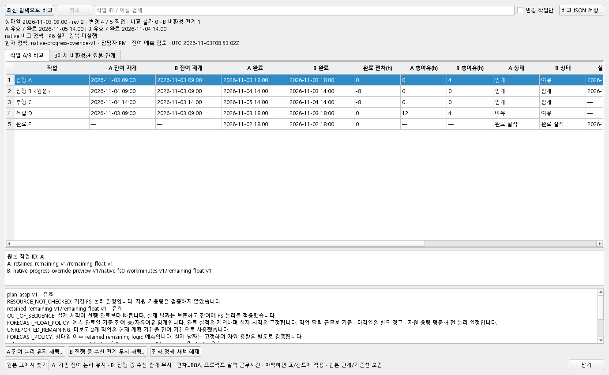
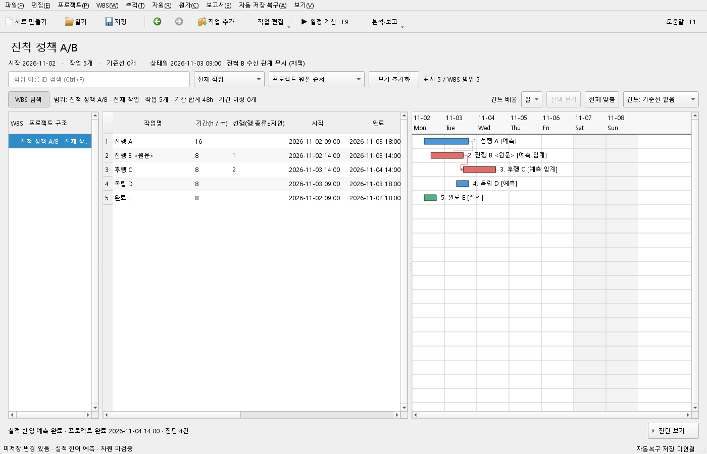

# 진척 정책 채택·저장 검증

Windows / Qt 6.8.3 / MinGW GCC 13.1 Release에서 [채택 계약](../../progress-policy-adoption.md)을 검증한다. 소스 식별값은 `61a70734b2786f450c569f168cb23548e439ab3533220813d07a63aaa85cc698`이며 src C++/헤더와 CMakeLists.txt 199개를 포함한다. [식별값·테스트/스크립트·실행 파일 해시](source-identity.json), [전체 소스 해시 목록](source-manifest.txt)을 보존한다.

## 최종 결과

- [전체 CTest 83/83 통과](ctest-windows-release.log), 257.52초. [각 시험의 상세 출력](ctest-final-details.log)을 보존한다.
- 파서 104개 seed와 schema1..13, 새 채택/저장·기존 비교 및 자원 UI 회귀를 포함한다.
- [형식 검사](format-gate.json) 132개 파일 통과. 새 출력과 기존 XLSX/PDF/XML/XER 독립 판독 11종을 통과했다.
- 최초 회귀에서 발견한 원시 body/envelope seed 기대값과 미해결 시나리오 저장 조건을 보정한 뒤 전체 83개를 다시 실행했다. [초기 진단 기록](ctest-initial.log)은 최종 성공 기록과 구분해 보존한다.

## 검사 범위

| 요구사항 | 확인한 동작 | 검사 |
|---|---|---|
| PROGRESS-POLICY-05 | A/B 채택·교체·해제, 비동기 계산의 한 번 적용, 즉시 표/간트 반영 | progress_policy_adoption_contract / ui |
| PROGRESS-POLICY-06 | 담당자·사유·UTC·검토 원본 저장, schema13, 재열기/SaveAs/복구, undo/redo, 입력 변경 후 유지·상태일 부재 시 비활성 | contract, parser_seed_replay |
| PROGRESS-POLICY-07 | 원본 관계·실제일·기준선·계획 예산 보존, 잔여 Usage/단가·보고/인쇄, 네트워크/Gantt 비활성 관계, XML/XER 손실 표시 | contract / ui, 독립 reader |
| PROGRESS-POLICY-08 | 제출 전/직전 취소, stale/reopen/session/메타데이터 입력 중 SaveAs, 읽기 전용, 평준화와 상호 배제·원본 부하 조회 | contract / ui, resource_ui |

원본 순서 위반 진단의 코드/대상은 보존하되 B의 설명에는 비활성 관계 정책을 표시한다. 미해결 평준화 시나리오 저장은 종전대로 허용하고 명시적 진척 정책 선택이 있을 때만 차단한다.

## 수기 예제와 독립 출력

선행 A의 계획은 월·화, B 계획은 수요일 8시간이다. B가 이미 시작된 상태에서 잔여 4시간을 보고했을 때 A 정책은 수요일 09:00~14:00, B 정책은 화요일 09:00~14:00에 잔여를 배치한다. 원본 B 계획 완료는 `2026-11-04 18:00`, 채택 B 예측 완료는 `2026-11-03 14:00`이다. 수요일부터 시간당 단가가 60에서 120으로 바뀌는 예제에서 계획 원가 960과 B 잔여 원가 240을 구분한다.

[독립 판독 결과](independent-reader.json)는 openpyxl 3.1.5 / pypdf 6.10.0으로 native checksum·schema13·원본 관계, XLSX 두 개의 실제/계획/잔여 날짜·총/자유여유·공수/원가·근거, PDF 보고서/Usage/일정 인쇄를 읽는다. 수식·외부 링크·VBA나 미리보기 정책 표시가 결과에 섞이지 않았는지도 검사한다. 원가 예제의 기준선 보존은 별도의 core fixture에서 승인 기준선을 생성해 확인한다.

- [native 선택 원본](adopted.ppm)
- [일반 보고서 XLSX](schedule.xlsx) · [PDF](schedule.pdf)
- [기간별 Usage XLSX](usage.xlsx) · [PDF](usage.pdf)
- [일정표·간트 인쇄 PDF](print.pdf)
- [1천/1만 작업 채택 B 계산 관측](core-metrics.json): 이 환경의 단일 관측이며 성능 보증/외부 제품 비교가 아니다.

## 재현과 경계

Qt/MinGW DLL 경로를 PATH에 넣은 뒤 `cmake --build build-forecast --parallel 4`, `ctest --test-dir build-forecast --output-on-failure`로 실행한다. 독립 새 출력 확인은 `.deps/report-verification/Scripts/python.exe scripts/verify-progress-policy-adoption.py build-forecast`다. 파서 seed는 [schema1..13·104개 재검증](parser-seed-recheck.log), 형식 검사는 [clang-format 18.1.8·132개 파일](format-gate.json)에 기록한다.

기존 XLSX/PDF/XML/XER reader의 기록은 `verify-*.log`에 보존한다. [P6 비교기 자체시험](verify-p6-selftest.log)은 합성 시험 6개와 MPXJ의 계획 부분 strict 읽기이며 실제 P6 실행이 아니다. P6는 미설치로 실제 재계산 왕복을 실행하지 않았다. P6 동등성, Actual Dates/Steps/LOE, 진척 정책과 평준화의 동시 채택, 새 sanitizer/coverage fuzz·서명/설치·원격 CI·macOS/Linux 실행은 이 기록의 검증 범위에 포함하지 않는다.
