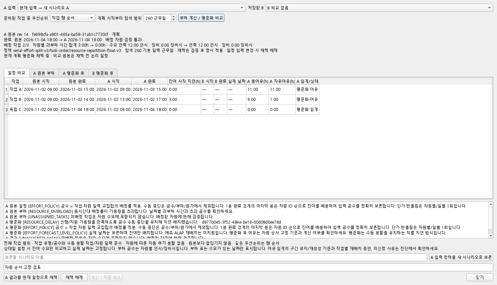
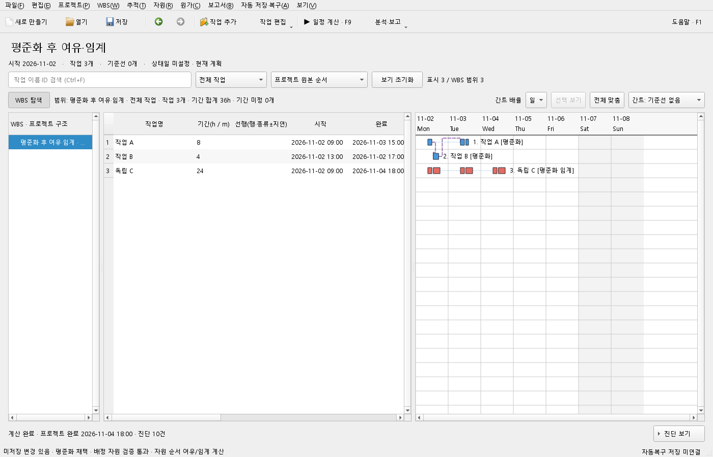

# 실행 구간 소멸·재분할 여유 검증

[계산·순서 정책](../../leveling-float.md)의 엔진1.3 증분을 Windows / Qt 6.8.3 / MinGW GCC 13.1 Release에서 검증한다. 기존 [실행 창 유지 엔진1.2 기록](../segment-leveling-float-2026-11-03/README.md)은 당시 증거로 보존한다.

## 최종 결과와 식별값

- [전체 CTest 88/88 통과](ctest-windows-release.log), 278.39초. [전체 상세](ctest-details.log).
- 이후 작업 표 snapshot의 `calculationPolicy` 전달 한 줄을 보완하고 tooltip 회귀를 추가해 [관련 UI/model 2/2](ctest-final-ui.log), 5.80초로 통과했다. [UI 상세](ctest-final-ui-details.log). 전체 실행 뒤 일정/탐색 엔진의 변경은 없다.
- 파서 seed **114개(schema1..14)**, [clang-format 18.1.8](format-gate.json) **145개 파일** 통과.
- 새/기존 출력의 독립 판독·자체시험 **16종** 통과. [전체 산출물 해시](evidence-manifest.json).

최종 src C++/헤더+CMake **204개** 파일 식별값은 `adbd98b6f4284d5f1345661a0877b03347ee98759640c2d426c1f8f3289760ee`다. [최종 목록](source-manifest.txt), [전체 회귀 당시 목록](source-manifest-full-test.txt), [시험/스크립트/바이너리 식별값](source-identity.json)을 구분한다. 전체 회귀 당시 `5509b33ad907f38529add61facb22868bec4d8d49bde06651be2644141029d54`와의 차이가 위 UI 전달 한 줄뿐임을 해시로 확인했다.

[native](selected.ppm), [XLSX](report.xlsx), [보고서 PDF](report.pdf), [인쇄 PDF](print.pdf)를 보존한다. 기존 판독 기록은 [전체 구간](verify-leveling-float.json), [교차 분할](verify-segment-leveling-float.json), [평준화 채택](verify-leveling-selection-exports.json), [진척+평준화](verify-progress-leveling.json), [진척 채택](verify-progress-policy-adoption.json), [기간 실적](verify-period-actual-exports.json), [Usage](verify-usage-exports.json), [분류](verify-classification-exports.json), [예측 여유](verify-forecast-float-exports.json), [인쇄](verify-schedule-print.json), [보고서](verify-report-fixtures.log), [XML](verify-project-xml.log), [XER](verify-primavera-xer.log), [다중 XER](verify-xer-project-selection.json), [P6 비교기 자체시험·MPXJ 계획 읽기](verify-p6-roundtrip.json)다. 실제 P6는 미실행이다.

## 수기 기대값과 독립 계산

A는 8시간이며 월요일 12시~화요일 9시 수동 중단이 있다. B는 같은 인력의 4시간 작업, C는 미배정 24시간 작업이다. 인력 용량과 A/B 배정률은 각각 100%다. 현재 배치는 A 월요일 09시~화요일 15시(중단·점심 제외), B 월요일 13~17시, C 월요일 09시~수요일 18시다.

| 작업 | 총여유 | 자유여유 | 총여유의 자기 시작 증인 | 임계 |
|---|---|---|---|---|
| A | 660분 | 660분 | 수요일 09시 | 아니오 |
| B | 540분 | 60분 | 화요일 14시 | 아니오 |
| C | 0분 | 0분 | 월요일 09시 | 예 |

A의 기존 앞 구간이 사라지고 수요일의 실행 구간으로 재생성된다. B의 총여유 증인에서는 A도 수요일로 늦춰 화요일 14~18시 자원을 비운다. B 자유여유는 현재 A를 고정하므로 60분이다. 현재 날짜·원본 수동 중단과 계획 예산 720은 바꾸지 않는다.

[독립 판독](verify-repartition-float.json)은 앱의 달력/탐색 코드를 호출하지 않는 Python 분 단위 달력·정수 bitset으로 가능한 A/B 배치를 전수 대조한다. 최종 자원 반환 B≤A와 실제 시간 중첩을 검사한 가능한 155,761쌍에서 위 최대값을 확인한다. 수요일 용량 0의 별도 전수 대조는 11,041쌍에서 A 총/자유 180분, B 총/자유 60분이다. 단순 자원 부하 이진 탐색으로 비단조 영역을 건너뛰지 않는 검사다.

동일 reader는 native schema12의 checksum·작업 ID·중단, XLSX의 총/자유여유·임계·증인·예산과 PDF·인쇄의 정책 출처를 대조한다. 별도 native 기준선 시험은 새1.3의 A 660분과 기존1.2의 A 179분을 각각 재현한다.

## 요구사항 연결

| 항목 | 수용 범위 |
|---|---|
| LEVEL-FLOAT-09 | 기존 구간 소멸·새 구간 생성, 고정 기간/고정 공수/고정 단위, 교차 작업 최종 반환 순서·비교차 슬롯 인계 |
| LEVEL-FLOAT-10 | 작업별 가능한 총여유 증인과 고정 날짜 자유여유, 논리 후행, 병렬 50% 배정, 유효일 용량/미정, FS0 근무 좌표와 실제 날짜 용량 구분 |
| LEVEL-FLOAT-11 | 표의 계산 기준 tooltip·간트/네트워크 현재 인계 참고·보고서/인쇄·native/XLSX/PDF와 분 단위 독립 전수 대조 |
| LEVEL-FLOAT-12 | 64작업 연결 묶음 한도·후보/판정 한도와 미산정, 취소·부분 결과 방지, 저장/재열기·Undo, 기존1.0~1.2/신규1.3 승인 기준선 |

## 범위와 재현

`repartition_float_contract`와 확장한 `leveling_float_ui`를 포함한 회귀를 실행한다. `leveling_float_contract`의 기존 수치 계약은 명시적 엔진1.2 범위에서 검사하며, 새 시험에서 기본 엔진1.3과 비교한다. Qt/MinGW DLL을 PATH에 두고 `cmake --build build-forecast --parallel 4`, `ctest --test-dir build-forecast --output-on-failure`로 재현한다. 독립 판독은 `.deps/report-verification/Scripts/python.exe scripts/verify-repartition-float.py build-forecast`다.

이 결과는 교차 작업의 최종 자원 반환 순서와 비교차 인계를 유지한 후보 중의 최대 여유다. 자원 순서가 완전히 자유로운 전역 최적화나 임의의 자원 선점 중단을 생성하는 기능은 포함하지 않는다. 작업별 최후 날짜는 각각의 증인 값이며 모든 최후 날짜를 합친 공통 일정이 아니다. 연결 묶음 64개 작업·후보 시작 250,000개·후보 실행 구간/탐색 판정 각각 2,000,000개 한도를 넘거나 용량이 미정이면 인증하지 않고 기존 날짜와 유효 상태를 보존한다.

[수기 계약 시험 시간](core-metrics.json)과 [혼합 1천/1만 작업 관측](mixed-size-metrics.json)을 보존한다. 혼합 입력은 교차 A/B 한 쌍과 짧은 독립 작업이며, 이미 준비된 배치의 파생 여유 계산만 133.43ms / 1,186.80ms로 관측했다. 연결된 모든 작업이 재분할되는 1만 작업 탐색이나 전체 평준화·파일 열기·화면 시간으로 확대하지 않는다. 날짜/프로필 준비는 측정 밖이다.

실제 P6 실행은 미설치로 미실행이다. 독립 MPXJ 계획 읽기와 합성 비교기 자체시험을 실제 P6 재계산으로 표시하지 않는다. 새 원격 CI·다른 OS·ASan/UBSan·coverage fuzz·패키징/설치·물리 프린터는 이번 로컬 검증에 포함하지 않는다.

