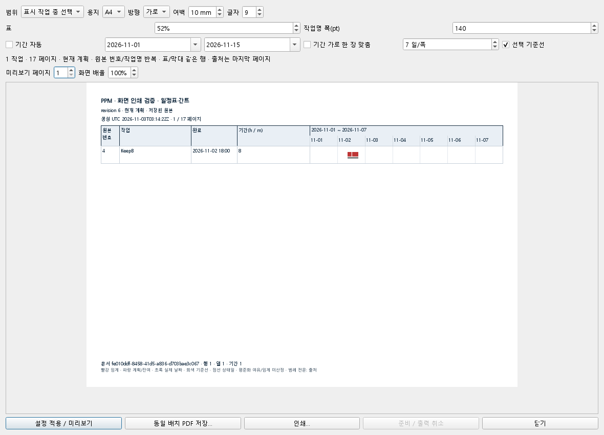
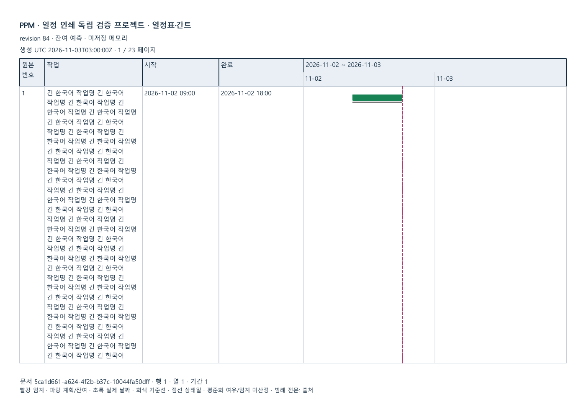
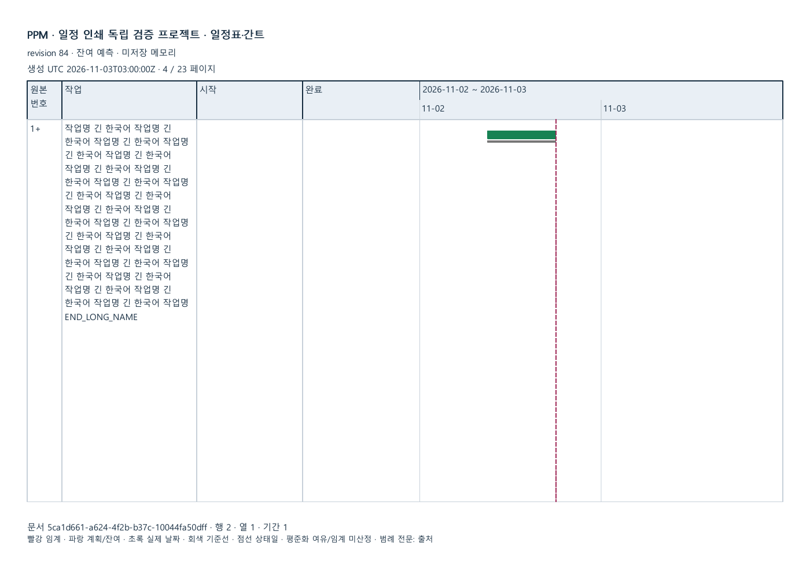
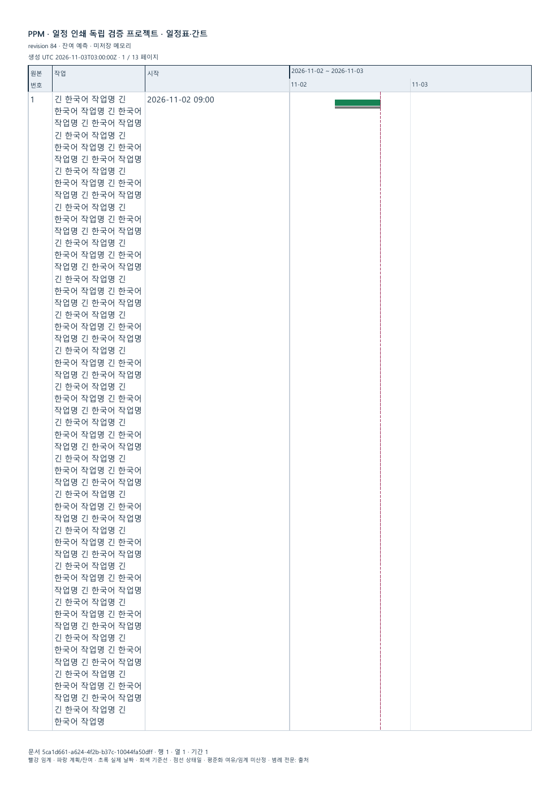
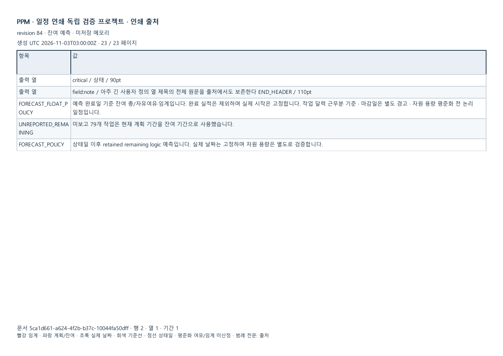

# 일정표·간트 인쇄 로컬 검증

> 당시 원시 자료·화면·로그는 [고정 원본](https://github.com/jhoon-dev/ProjectPlanningManager/tree/77bb5a1cead1cb2c47f36e57b00d478746f32434/docs/validation/schedule-printing-2026-11-03)에 보존되어 있습니다. 새 실행 결과는 CI 산출물로 보관합니다.

2026-11-03 [GAP-07 native 인쇄 계약](../../schedule-printing.md)의 Windows Release / Qt 6.8.3 / MinGW GCC 13.1.0 결과다. **전체 CTest 75개 통과, 실패 0개, 216.83초**다. [전체 요약](https://github.com/jhoon-dev/ProjectPlanningManager/blob/77bb5a1cead1cb2c47f36e57b00d478746f32434/docs/validation/schedule-printing-2026-11-03/full-ctest.log), [시험별 출력](https://github.com/jhoon-dev/ProjectPlanningManager/blob/77bb5a1cead1cb2c47f36e57b00d478746f32434/docs/validation/schedule-printing-2026-11-03/ctest-details.log), [제품 빌드](https://github.com/jhoon-dev/ProjectPlanningManager/blob/77bb5a1cead1cb2c47f36e57b00d478746f32434/docs/validation/schedule-printing-2026-11-03/build.log), [시험 준비 코드 수정 빌드](https://github.com/jhoon-dev/ProjectPlanningManager/blob/77bb5a1cead1cb2c47f36e57b00d478746f32434/docs/validation/schedule-printing-2026-11-03/fixture-fix-build.log)를 보존한다.

| 검사 | 결과 |
|---|---|
| 페이지 배치 | 80개 작업, 여러 열/세로·기간 페이지, 긴 한국어 작업명/셀 이어짐, 긴 열 제목 전문, 원본 번호/작업명 반복, 표/막대 같은 행 확인 |
| 날짜·구간 | 오래된 화면 날짜를 새 계산으로 교체, 완료 실제·기준선·상태일·수동 분할·잔여 임계와 평준화 미산정 확인 |
| 독립 출력 | PDF 6개: 일정 23쪽, 300dpi QPrinter PDF 23쪽, 범위/역순/복사 4쪽, A3 세로/12pt 13쪽, 기간 나눔 65쪽, 평준화 23쪽. 양 장치의 모든 페이지 텍스트/순서 일치, 범위 결과 3/3/2/2 확인 |
| 화면·보호 | 검색/정렬/선택·숨긴/이동한 열, 미리보기 옵션 무효화·재준비·취소, 읽기 전용, 같은 ID 재열기, 파일 선택 중 문서 변경 차단, 기존 PDF 보존·취소 출력 미게시 확인 |
| 기존 회귀 | 이전 보고서 XLSX 5개/PDF 6개와 Usage·분류·예측 여유·기간 실적·평준화의 독립 검사 통과. schema1~12 seed 90개 유지 |
| 품질·의존성 | clang-format 18.1.8 105개 파일·변경 없음, diff/link 검사 통과. 패키징 계약 18개 통과/SDK 의존 2개 skip. PE 연결과 windeployqt dry-run에서 Qt6PrintSupport.dll 발견 |

초기 전체 회귀에서 기존 평준화 화면 시험의 데이터 준비가 간헐적으로 `TASK_NOT_FOUND`로 실패했다. 문서를 수정하는 동안 빌린 작업 목록을 계속 순회하는 시험 준비 코드를 owning snapshot 순회로 수정했다. [초기 기록](https://github.com/jhoon-dev/ProjectPlanningManager/blob/77bb5a1cead1cb2c47f36e57b00d478746f32434/docs/validation/schedule-printing-2026-11-03/initial-ctest.log)을 보존하고 두 평준화 fixture를 수정한 뒤 위 전체 75개를 다시 통과했다. 제품의 배정/일정 계산은 바꾸지 않았다.

[기계 판독 기록](https://github.com/jhoon-dev/ProjectPlanningManager/blob/77bb5a1cead1cb2c47f36e57b00d478746f32434/docs/validation/schedule-printing-2026-11-03/verification.json), [소스 식별](https://github.com/jhoon-dev/ProjectPlanningManager/blob/77bb5a1cead1cb2c47f36e57b00d478746f32434/docs/validation/schedule-printing-2026-11-03/source-identity.json), [인쇄 독립 검사](https://github.com/jhoon-dev/ProjectPlanningManager/blob/77bb5a1cead1cb2c47f36e57b00d478746f32434/docs/validation/schedule-printing-2026-11-03/independent-print-exports.json), [파서 기록](https://github.com/jhoon-dev/ProjectPlanningManager/blob/77bb5a1cead1cb2c47f36e57b00d478746f32434/docs/validation/schedule-printing-2026-11-03/parser-seed-replay.log), [포맷 검사](https://github.com/jhoon-dev/ProjectPlanningManager/blob/77bb5a1cead1cb2c47f36e57b00d478746f32434/docs/validation/schedule-printing-2026-11-03/format-check.json), [문서 링크 검사](https://github.com/jhoon-dev/ProjectPlanningManager/blob/77bb5a1cead1cb2c47f36e57b00d478746f32434/docs/validation/schedule-printing-2026-11-03/markdown-links.json), [배포 의존성 발견](https://github.com/jhoon-dev/ProjectPlanningManager/blob/77bb5a1cead1cb2c47f36e57b00d478746f32434/docs/validation/schedule-printing-2026-11-03/deployment-dry-run.log), [패키징 시험](https://github.com/jhoon-dev/ProjectPlanningManager/blob/77bb5a1cead1cb2c47f36e57b00d478746f32434/docs/validation/schedule-printing-2026-11-03/packaging-tests.log)을 참조한다. 제품 소스 SHA-256은 `e171b08f18562f38647121f00a0f31645edfad2db2b8375e9d703fa550bae207`이며 빌드 값과 일치한다. src cpp/h·CMakeLists.txt 레시피는 tests/mm/scripts를 제외하며 관련 시험/검증 스크립트는 별도 해시로 기록한다. 이전 증분의 검증 폴더/해시는 수정하지 않았다.

재현: `ctest --test-dir build-forecast -R schedule_print --output-on-failure`, `.deps/report-verification/Scripts/python.exe scripts/verify-schedule-print.py build-forecast`. 앱 자체는 Python/Office 없이 출력한다. 아래는 실제 PDF를 Poppler로 렌더링한 결과이며 QPainter 직접 이미지가 아니다. 전체 PDF의 텍스트/페이지는 pypdf로 독립 확인했다.

## 화면과 PDF 렌더링 확인

## 미실행과 범위

실제 물리 프린터/드라이버, 네이티브 프린터 선택 창의 취소/설정 조작, macOS/Linux, CI, clang-tidy, ASan/UBSan, coverage fuzz, 실제 데스크톱/접근성 조작, 새로운 1천/1만 인쇄 성능 측정과 MSIX/스토어 패키징·서명·제출은 미실행이다. QPrinter PDF 검사를 실제 프린터 검증으로 확대하지 않는다. dry-run은 새 의존성 발견 검사이며 실제 배포 payload/설치 검증은 아니다. 프로젝트 schema와 원장은 유지하며 개인 페이지 설정 저장·WBS 요약 행/관계 화살표 출력은 후속이다.
