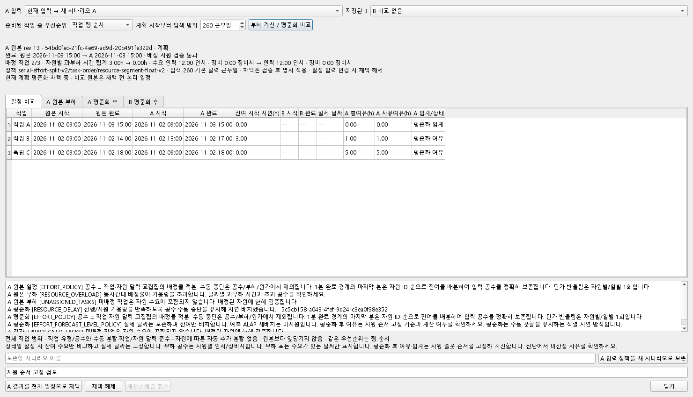
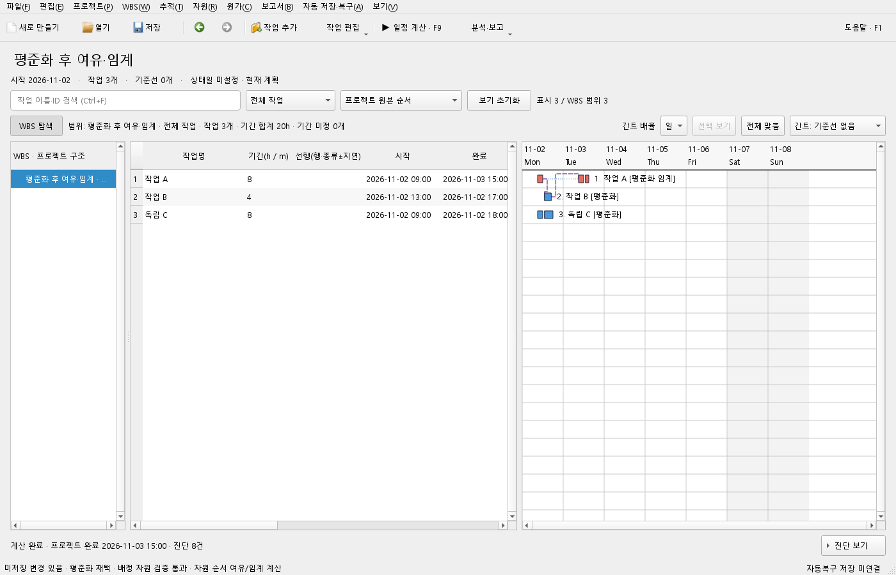

# 교차 분할 평준화 후 여유·임계 검증

> 당시 원시 자료·화면·로그는 [고정 원본](https://github.com/jhoon-dev/ProjectPlanningManager/tree/77bb5a1cead1cb2c47f36e57b00d478746f32434/docs/validation/segment-leveling-float-2026-11-03)에 보존되어 있습니다. 새 실행 결과는 CI 산출물로 보관합니다.

[계산·호환 계약](../../leveling-float.md)의 실행 창 증분을 Windows / Qt 6.8.3 / MinGW GCC 13.1 Release에서 검증한다. 이전 [전체 구간 증분](../leveling-float-2026-11-03/README.md)의 기록은 당시 소스·산출물로 보존한다.

src C++/헤더+CMake 203개 파일의 식별값은 `3c9469cf4acbcb364de1e4daac8c492c2c395845810fef618f8ae64efc97611d`다. [전체 목록](https://github.com/jhoon-dev/ProjectPlanningManager/blob/77bb5a1cead1cb2c47f36e57b00d478746f32434/docs/validation/segment-leveling-float-2026-11-03/source-manifest.txt)과 [시험·스크립트·바이너리 식별값](https://github.com/jhoon-dev/ProjectPlanningManager/blob/77bb5a1cead1cb2c47f36e57b00d478746f32434/docs/validation/segment-leveling-float-2026-11-03/source-identity.json)을 보존한다.

## 최종 결과

- 검증 대상 **87개 모두 최종 통과**. [전체 실행](https://github.com/jhoon-dev/ProjectPlanningManager/blob/77bb5a1cead1cb2c47f36e57b00d478746f32434/docs/validation/segment-leveling-float-2026-11-03/ctest-windows-release.log)은 333.02초, 86/87 통과다. 남아 있던 UI 시험 출력 파일 때문에 SaveAs 보호가 작동한 1건은 시험 소유 파일 정리만 수정한 뒤 [해당 UI 재실행 1/1](https://github.com/jhoon-dev/ProjectPlanningManager/blob/77bb5a1cead1cb2c47f36e57b00d478746f32434/docs/validation/segment-leveling-float-2026-11-03/ctest-rerun.log), 3.89초로 통과했다. 제품 src/CMake는 두 실행에서 동일하다. [전체 상세](https://github.com/jhoon-dev/ProjectPlanningManager/blob/77bb5a1cead1cb2c47f36e57b00d478746f32434/docs/validation/segment-leveling-float-2026-11-03/ctest-details.log), [UI 재실행 상세](https://github.com/jhoon-dev/ProjectPlanningManager/blob/77bb5a1cead1cb2c47f36e57b00d478746f32434/docs/validation/segment-leveling-float-2026-11-03/ctest-rerun-details.log), [합산 판정](https://github.com/jhoon-dev/ProjectPlanningManager/blob/77bb5a1cead1cb2c47f36e57b00d478746f32434/docs/validation/segment-leveling-float-2026-11-03/verification-summary.json)을 구분해 보존한다.
- schema1..14의 파서 seed **114개**, [clang-format 18.1.8 검사](https://github.com/jhoon-dev/ProjectPlanningManager/blob/77bb5a1cead1cb2c47f36e57b00d478746f32434/docs/validation/segment-leveling-float-2026-11-03/format-gate.json) **142개 파일** 통과.
- 새/기존 출력의 독립 판독·자체시험 **15종** 통과. [산출물 해시](https://github.com/jhoon-dev/ProjectPlanningManager/blob/77bb5a1cead1cb2c47f36e57b00d478746f32434/docs/validation/segment-leveling-float-2026-11-03/evidence-manifest.json).

[native 파일](https://github.com/jhoon-dev/ProjectPlanningManager/blob/77bb5a1cead1cb2c47f36e57b00d478746f32434/docs/validation/segment-leveling-float-2026-11-03/selected.ppm), [보고서 XLSX](https://github.com/jhoon-dev/ProjectPlanningManager/blob/77bb5a1cead1cb2c47f36e57b00d478746f32434/docs/validation/segment-leveling-float-2026-11-03/report.xlsx)/[PDF](https://github.com/jhoon-dev/ProjectPlanningManager/blob/77bb5a1cead1cb2c47f36e57b00d478746f32434/docs/validation/segment-leveling-float-2026-11-03/report.pdf), [인쇄 PDF](https://github.com/jhoon-dev/ProjectPlanningManager/blob/77bb5a1cead1cb2c47f36e57b00d478746f32434/docs/validation/segment-leveling-float-2026-11-03/print.pdf)를 보존한다. 독립 기록: [교차 분할](https://github.com/jhoon-dev/ProjectPlanningManager/blob/77bb5a1cead1cb2c47f36e57b00d478746f32434/docs/validation/segment-leveling-float-2026-11-03/verify-segment-leveling-float.json), [기존 전체 구간 여유](https://github.com/jhoon-dev/ProjectPlanningManager/blob/77bb5a1cead1cb2c47f36e57b00d478746f32434/docs/validation/segment-leveling-float-2026-11-03/verify-leveling-float.json), [평준화 채택](https://github.com/jhoon-dev/ProjectPlanningManager/blob/77bb5a1cead1cb2c47f36e57b00d478746f32434/docs/validation/segment-leveling-float-2026-11-03/verify-leveling-selection-exports.json), [진척+평준화](https://github.com/jhoon-dev/ProjectPlanningManager/blob/77bb5a1cead1cb2c47f36e57b00d478746f32434/docs/validation/segment-leveling-float-2026-11-03/verify-progress-leveling.json), [진척 채택](https://github.com/jhoon-dev/ProjectPlanningManager/blob/77bb5a1cead1cb2c47f36e57b00d478746f32434/docs/validation/segment-leveling-float-2026-11-03/verify-progress-policy-adoption.json), [기간 실적](https://github.com/jhoon-dev/ProjectPlanningManager/blob/77bb5a1cead1cb2c47f36e57b00d478746f32434/docs/validation/segment-leveling-float-2026-11-03/verify-period-actual-exports.json), [Usage](https://github.com/jhoon-dev/ProjectPlanningManager/blob/77bb5a1cead1cb2c47f36e57b00d478746f32434/docs/validation/segment-leveling-float-2026-11-03/verify-usage-exports.json), [분류](https://github.com/jhoon-dev/ProjectPlanningManager/blob/77bb5a1cead1cb2c47f36e57b00d478746f32434/docs/validation/segment-leveling-float-2026-11-03/verify-classification-exports.json), [예측 여유](https://github.com/jhoon-dev/ProjectPlanningManager/blob/77bb5a1cead1cb2c47f36e57b00d478746f32434/docs/validation/segment-leveling-float-2026-11-03/verify-forecast-float-exports.json), [인쇄](https://github.com/jhoon-dev/ProjectPlanningManager/blob/77bb5a1cead1cb2c47f36e57b00d478746f32434/docs/validation/segment-leveling-float-2026-11-03/verify-schedule-print.json), [일반 보고서](https://github.com/jhoon-dev/ProjectPlanningManager/blob/77bb5a1cead1cb2c47f36e57b00d478746f32434/docs/validation/segment-leveling-float-2026-11-03/verify-report-fixtures.log), [Project XML](https://github.com/jhoon-dev/ProjectPlanningManager/blob/77bb5a1cead1cb2c47f36e57b00d478746f32434/docs/validation/segment-leveling-float-2026-11-03/verify-project-xml.log), [Primavera XER](https://github.com/jhoon-dev/ProjectPlanningManager/blob/77bb5a1cead1cb2c47f36e57b00d478746f32434/docs/validation/segment-leveling-float-2026-11-03/verify-primavera-xer.log), [다중 XER 선택](https://github.com/jhoon-dev/ProjectPlanningManager/blob/77bb5a1cead1cb2c47f36e57b00d478746f32434/docs/validation/segment-leveling-float-2026-11-03/verify-xer-project-selection.json), [P6 비교기 자체시험·MPXJ 읽기](https://github.com/jhoon-dev/ProjectPlanningManager/blob/77bb5a1cead1cb2c47f36e57b00d478746f32434/docs/validation/segment-leveling-float-2026-11-03/verify-p6-roundtrip.json).

## 수기 기대값

인력 가용량 100%, A/B의 배정률 각각 100%, A 8시간, B 4시간, 독립 C 8시간이다. A는 2026-11-02 12:00~11-03 09:00 수동 중단이 있다.

| 작업 | 평준화 시작 | 완료 | 총여유 | 자유여유 | 임계 |
|---|---|---|---|---|---|
| A | 11-02 09:00 | 11-03 15:00 | 0분 | 0분 | 예 |
| B | 11-02 13:00 | 11-02 17:00 | 60분 | 60분 | 아니오 |
| C | 11-02 09:00 | 11-02 18:00 | 300분 | 300분 | 아니오 |

A 앞 구간 완료 11-02 12시→B 시작 13시, B 완료 17시→A 재개 11-03 9시를 별도 자원 인계로 표시한다. A 전체 완료→B 전체 시작의 FS로 연결하지 않는다. 원본 날짜·중단·작업량과 계획 예산 720을 보존한다. [독립 native/XLSX/PDF 판독](https://github.com/jhoon-dev/ProjectPlanningManager/blob/77bb5a1cead1cb2c47f36e57b00d478746f32434/docs/validation/segment-leveling-float-2026-11-03/verify-segment-leveling-float.json).

독립 C를 24시간으로 늘리면 A는 179분의 총/자유여유를 갖는다. A를 11-02 11:59로 늦추면 첫 구간이 1분으로 줄고 나머지는 기존 실행 모델로 재배분된다. 12시 이후는 첫 구간을 없애는 순서 변경이므로 제외한다. 구간 작업량 자체를 고정해서 여유를 0으로 잘못 계산하지 않는 사례다. B를 5시간으로 바꾼 별도 fixture는 B→A 재개 구간이 driving이고 A/B 모두 임계인 것을 검사한다.

## 요구사항과 보호

| 항목 | 검사 |
|---|---|
| LEVEL-FLOAT-05 | 고정 기간/고정 공수/고정 단위, 실행 창 분해, A→B→A, 179분 내부 작업량 재배분 |
| LEVEL-FLOAT-06 | 다중 자원·병렬 용량/가용량 감소, B 진척 정책의 관계 마스크·실제 시작/잔여 재개 보존, 최후 창 예약과 실제 수요 검증 |
| LEVEL-FLOAT-07 | 비교·표·간트 인계 시각 tooltip, 네트워크 구간 metadata, XLSX의 총/자유여유/임계·인계 시각과 PDF·인쇄의 정책 출처 |
| LEVEL-FLOAT-08 | 기존1.0/1.1 재현, 신규1.2 기준선, native schema12 저장·재열기/기준선·Undo·기존 취소 회귀 |

`leveling_float_contract`와 `leveling_float_ui`를 확장하고 기존 전체 회귀를 실행한다. `.deps/report-verification/Scripts/python.exe scripts/verify-segment-leveling-float.py build-forecast`는 Python 표준 JSON/SHA256, openpyxl 3.1.5, pypdf 6.10.0으로 출력의 별도 기대값을 판독한다. `cmake --build build-forecast --parallel 4`, `ctest --test-dir build-forecast --output-on-failure`로 재현한다. Qt/MinGW DLL 경로가 PATH에 있어야 한다.

이 값은 기존 실행 창과 자원 인계 순서를 유지한 여유다. 구간 소멸·다른 순서로 재분할·자원 순서 재최적화의 전역 최대 여유는 포함하지 않는다. 실행 창 100,000개, 작업 10,000개, 관계 250,000개, 후진 판정 2,000,000회 한도를 적용한다. 지원 경계 밖에서는 날짜를 보존하고 미산정 사유를 표시한다. 파일 schema는 추가하지 않고 새 선택 계획 기준선에 엔진1.2를 기록한다.

## 규모 관측

[계산 관측](https://github.com/jhoon-dev/ProjectPlanningManager/blob/77bb5a1cead1cb2c47f36e57b00d478746f32434/docs/validation/segment-leveling-float-2026-11-03/core-metrics.json)은 위의 교차 분할 A/B 한 쌍과 독립 1분 작업을 섞은 1천/1만 작업의 이미 준비된 배치에 파생 여유 계산만 수행한 단회 측정이다. 각각 94.31ms / 841.15ms였다. A/B의 구간 인계 2개·A 임계·B 총여유 60분도 검사한다. 전체 평준화 알고리즘, 1만 개 모두가 서로 교차하는 배치, 파일 열기나 화면 표시의 시간으로 확대하지 않는다. 출력/원본 준비는 측정에서 제외한다.

실제 P6 실행은 미설치로 미실행이다. MPXJ 계획 읽기와 P6 비교기 합성 자체시험을 실제 제품 재계산 증거로 사용하지 않는다. 새 원격 CI·다른 OS·ASan/UBSan·coverage fuzz·패키징/설치·물리 프린터 검증은 이번 로컬 기록에 포함하지 않는다.

