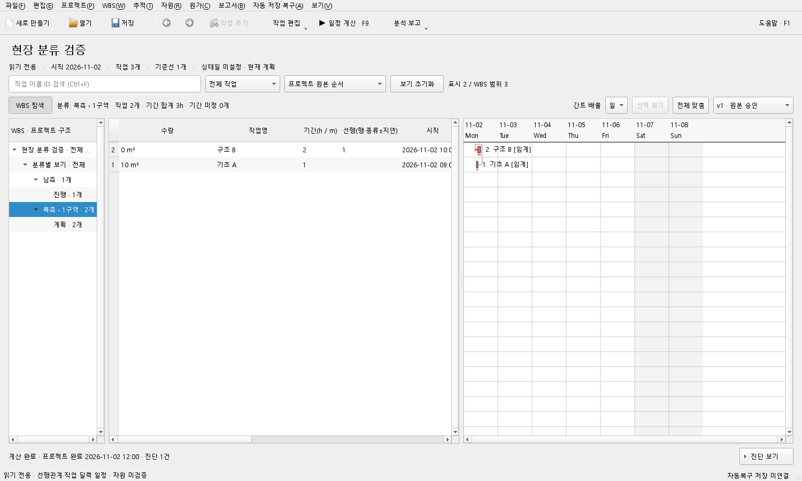

# 작업 분류·그룹·저장된 보기 검증

> 당시 원시 자료·화면·로그는 [고정 원본](https://github.com/jhoon-dev/ProjectPlanningManager/tree/77bb5a1cead1cb2c47f36e57b00d478746f32434/docs/validation/task-classification-2026-11-02)에 보존되어 있습니다. 새 실행 결과는 CI 산출물로 보관합니다.

2026-11-02. 사용자 후속 요청에 따른 GAP-03의 작업 객체 증분이다. [사용 방법과 계약](../../task-classification.md), [PRD](../../planning/01-product-prd.md), [기능 우선순위](../../planning/16-product-gap-priorities.md)를 연결한다. 전체 객체 범위나 MSP/P6 동등성의 완료 기록은 아니다.

## 구현과 결과

- 작업 필드 네 형식(텍스트·숫자·날짜·목록), 안정 ID를 가진 목록 옵션·계층형 코드, 다중 작업 배정과 삭제 보호를 추가했다. 숫자는 소수 6자리의 정확한 고정소수이며 빈 문자열·0·미설정을 구분한다.
- 최대 3단계 그룹, 분류 필터·정렬, 열 순서·폭·숨김과 이름 있는 보기를 제공한다. WBS·원본 작업 ID/선행 번호·계산 그래프를 보존한다. 그룹은 고유 작업 수·알려진 기간 합계·기간 미정 수를 표시한다.
- 기준선/시나리오의 사전·값 동결, undo/redo·dirty·읽기 전용·복제·파일/복구를 연결했다. 보기 저장/삭제는 유효한 일정 결과를 유지한다.
- 새 데이터는 native schema 10에 저장하고 데이터가 없으면 schema 9 writer를 유지한다. XML/XER에는 분류를 매핑하지 않고 손실 진단 및 전체 `source.ppm` 보존으로 처리한다.
- 그룹 밖 작업을 진단/탐색으로 선택할 때 필터를 해제한 뒤 해당 작업의 선택이 풀리던 문제를 수정했다.

**전체 CTest 67개 통과, 189.30초.** [전체 로그](https://github.com/jhoon-dev/ProjectPlanningManager/blob/77bb5a1cead1cb2c47f36e57b00d478746f32434/docs/validation/task-classification-2026-11-02/full-ctest.log)와 [검증 요약·소스 식별](https://github.com/jhoon-dev/ProjectPlanningManager/blob/77bb5a1cead1cb2c47f36e57b00d478746f32434/docs/validation/task-classification-2026-11-02/verification.json)을 보존한다. Release 빌드와 [clang-format 18.1.8 검사](https://github.com/jhoon-dev/ProjectPlanningManager/blob/77bb5a1cead1cb2c47f36e57b00d478746f32434/docs/validation/task-classification-2026-11-02/format.json)도 통과했다.

| 검사 | 검증 내용 |
|---|---|
| `task_classification_contract` | 네 형식·수치 범위/정규화·0/빈문자열/미설정, 목록/코드 ID, 이름/부모 변경, 순환/깊이/잘못된 참조·삭제 보호 |
| 편집·불변 입력 | 다중 배정 실패 원자성, 복제, undo/redo, 기준선 동결·분류 변경 비교, 저장된 보기의 유효 계산 유지 |
| 파일·복구 | schema 10 roundtrip·읽기 전용·사본·실제 복구 checkpoint와 claim, schema 9 writer 유지, 미지원 버전·알 수 없는 중첩 필드 거절 |
| projection | 숫자 오름차순/내림차순, 미설정 뒤 배치, 빈 문자열과 미설정 필터 분리, 그룹 고유 개수·알려진 기간·미정 수, 선택 후 원본 행 ID |
| `task_classification_ui` | 실제 Qt 메뉴/대화상자로 정의 추가·잘못된 값 거절·다중 배정·사용 중 코드 삭제 차단, 2단계 그룹·간트/선행 번호, 열 위치/180px 폭/숨김·보기 저장/재적용·읽기 전용 |
| parser seed replay | native schema 1~10·분류/보기 seed를 포함한 72개 재생, checksum/body 분리·엄격 필드·byte 제한. coverage-guided fuzzing 실행과 구분 |
| 기존 회귀 | 일정·공수·실적·기준선·원가·여유·평준화·다중 프로젝트·편집·파일/복구·XML/XER·보고·업데이트/패키지 계약 |

## 출력과 화면

[독립 출력 검사](https://github.com/jhoon-dev/ProjectPlanningManager/blob/77bb5a1cead1cb2c47f36e57b00d478746f32434/docs/validation/task-classification-2026-11-02/independent-export.json)는 openpyxl로 분류 명세 12행(3작업 × 4키), 숫자 셀의 `10`, `0`, `-0.125001`, 미설정과 코드 경로, 수식·외부 링크·VBA 부재를 대조했다. pypdf로 7페이지의 한국어 분류 레이블·코드·6자리 음수와 제어문자 부재를 확인했다. 화면에서 2작업만 보이는 상태에도 보고서는 선택한 WBS 전체의 3작업을 포함한다.

기존 보고 fixture의 XLSX 5개/PDF 6개와 GAP-01 예측 출력도 독립 reader로 재검사해 통과했다. PDF 텍스트 검사는 페이지 렌더링 시각 QA를 대신하지 않는다.



Qt offscreen 화면이다. 수량 열이 첫 열로 이동해 B의 0과 A의 10을 오름차순으로 표시하며, 원본 선행 번호와 그룹 범위의 두 간트 막대를 유지한다. 읽기 전용 파일에도 저장된 보기 적용은 가능하다. 글꼴은 Windows 맑은 고딕을 명시 로드했다.

## 1천/1만 작업 화면 적용 측정

Windows·MinGW GCC 13.1·Qt 6.8.3·Release에서 100개 폭의 선행 체인과 20개 코드·5개 범주를 가진 fixture를 사용했다. 2단계 분류의 그룹 노드는 40개다. 같은 프로세스에서 매번 초기 보기로 복귀한 다음 저장된 보기를 3회 적용했다. 측정은 Qt offscreen의 보기 선택 대화상자·트리·모델·간트 갱신을 포함하며 순수 계산 엔진 측정이 아니다. [모든 원시 표본](https://github.com/jhoon-dev/ProjectPlanningManager/blob/77bb5a1cead1cb2c47f36e57b00d478746f32434/docs/validation/task-classification-2026-11-02/performance.json)을 보존한다.

| 작업 수 | 중앙값(ms) | 관측 P95(ms) | 표본(ms) |
|---|---|---|---|
| 1,000 | 94.78 | 164.53 | 164.5265 / 85.0585 / 94.7758 |
| 10,000 | 147.12 | 197.94 | 197.9374 / 144.5315 / 147.1235 |

3회 표본의 nearest-rank P95는 최댓값이며 지연 보장이 아니다. 변경 전 성능 비교·메모리·1만 개 고유 그룹은 측정하지 않았다. 실제 고객 데이터나 네이티브 데스크톱 상호작용의 응답성을 대신하지 않는다.

제품 소스 SHA-256은 `5b9291592dc1384957c031b7536cb6a2f794b19878c814fb09ccad4e72af2021`이다. 정렬한 `src/**/*.cpp`, `src/**/*.h`, `CMakeLists.txt`의 파일별 SHA-256 manifest를 사용했고 `build-forecast/BuildIdentity.h`와 일치한다. Git 기준은 `6a1cd0a5115f3400d6cee4e5d5df795f351195ea + dirty`이며 새 커밋/CI/배포는 만들지 않았다. 주요 검사 소스와 증거 파일 hash는 verification.json에 기록한다. 이전 GAP-01 검증 폴더는 당시 기록을 유지한다.

## 재현과 남은 범위

Qt/MinGW의 `bin`, CMake/Ninja를 PATH에 두고 실행한다. 기존 `build` 캐시는 옛 경로를 가리켜 `build-forecast`를 사용했다.

```powershell
cmake -S . -B build-forecast -G Ninja -DCMAKE_BUILD_TYPE=Release -DCMAKE_PREFIX_PATH=.deps/Qt/6.8.3/mingw_64
cmake --build build-forecast --parallel 4
ctest --test-dir build-forecast --output-on-failure
python scripts/verify-classification-exports.py build-forecast
python scripts/verify-report-fixtures.py build-forecast
python scripts/verify-forecast-float-exports.py build-forecast
```

독립 reader에는 기존 선택 개발 의존성 openpyxl/pypdf가 필요하다. 새 UI 검사에서 화면·XLSX/PDF·측정 JSON을 `build-forecast/classification-qa`에 생성한다.

- 프로젝트/자원 필드·계산식·MSP/P6 UDF/코드/보기 매핑과 그룹별 공수·원가 소계는 후속이다. 외부 파일만 전달하면 분류 데이터가 전달되지 않는다.
- TSV 붙여넣기는 기존 작업명·기간·선행 세 열이다. 분류 열은 개별 편집 또는 선택 작업 분류 대화상자를 사용한다.
- macOS/Linux·CI·ASan/UBSan·coverage-guided fuzzing·실제 MSP/P6 재계산/재저장·실제 프린터·사용자 업무 수용은 이번 증분에서 실행하지 않았다.
- 일/주/월의 작업·자원 Usage 조회와 기간별 실적 입력은 GAP-04로 남긴다. 누적 실적만으로 일별 자원 실적을 추정 생성하지 않는다.
