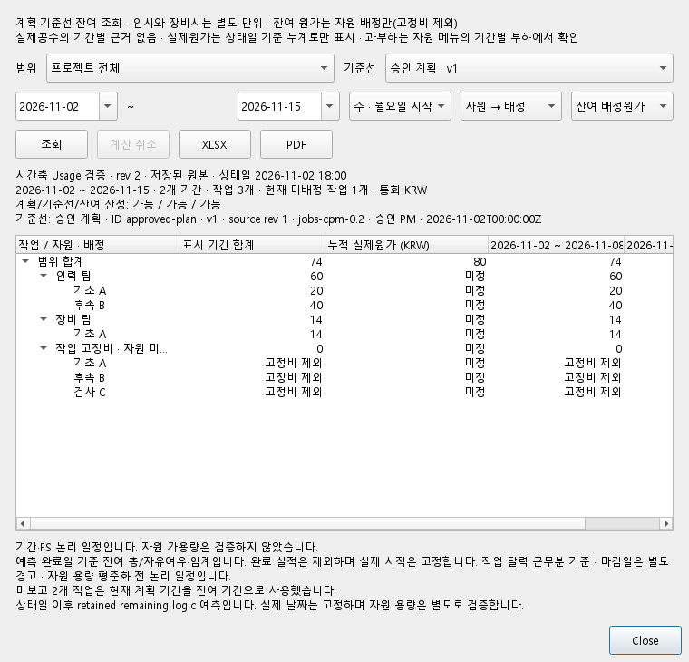

# 작업·자원 시간축 Usage 검증

> 당시 원시 자료·화면·로그는 [고정 원본](https://github.com/jhoon-dev/ProjectPlanningManager/tree/77bb5a1cead1cb2c47f36e57b00d478746f32434/docs/validation/timephased-usage-2026-11-03)에 보존되어 있습니다. 새 실행 결과는 CI 산출물로 보관합니다.

2026-11-03 사용자 다음 단계 요청에 따른 GAP-04의 조회/출력 증분이다. [사용 방법·계산 계약](../../timephased-usage.md), [PRD](../../planning/01-product-prd.md), [우선순위](../../planning/16-product-gap-priorities.md)를 따른다. 기간별 실제 입력과 실제 배정/원가 원장 확대는 후속이다.

## 결과와 범위

**전체 CTest 69개 통과, 237.67초.** 새 `timephased_usage_contract`와 `timephased_usage_ui`, 기존 일정·공수·원가·분류·예측·교환·파일/복구 회귀를 포함한다. Release 빌드와 [clang-format 18.1.8](https://github.com/jhoon-dev/ProjectPlanningManager/blob/77bb5a1cead1cb2c47f36e57b00d478746f32434/docs/validation/timephased-usage-2026-11-03/format.json), 독립 출력 검사도 통과했다. [전체 실행 로그](https://github.com/jhoon-dev/ProjectPlanningManager/blob/77bb5a1cead1cb2c47f36e57b00d478746f32434/docs/validation/timephased-usage-2026-11-03/full-ctest.log)와 [검증 요약·소스/증거 식별](https://github.com/jhoon-dev/ProjectPlanningManager/blob/77bb5a1cead1cb2c47f36e57b00d478746f32434/docs/validation/timephased-usage-2026-11-03/verification.json)을 보존한다.

- 일/주/월 기간과 작업→배정·자원→배정 계층에서 계획·승인 기준선·잔여 공수/원가를 조회한다. 인시/장비시를 따로 집계하고 고정비를 별도 행으로 한 번만 포함한다.
- 기준선의 사전·단가·일정을 동결하고 삭제된 기준선 작업/배정을 안정 ID의 합집합에 보존한다. 일정 미확정·기준선/상태일 미설정·단가/고정비 미정과 알려진 0을 구분한다.
- 실제원가는 상태일의 최신 작업 누계다. 기간/자원으로 추정 배분하지 않고 별도 열/명세로 표시한다. 잔여 원가는 배정 자원만 포함하며 고정비는 제외하고 EAC/ETC와 구분한다.
- worker 취소·조건 변경·문서 session/ID/revision/저장 상태 보호를 추가했다. 읽기 전용 조회·출력을 제공하며 영속 입력·파일 schema·실적/원가 원장을 변경하지 않는다.
- 작은 화면에서 식별/누계 열이 시간축을 모두 가리지 않도록 기본 열 폭을 조정했다. 표시 범위만 합산하고 과부하 판단은 기존 동시간대 부하 계산을 유지한다.

## 독립 기대값

월~금 09–12/13–18, 휴일 없는 `2026-11-02` 시작의 fixture다. A는 16h 기간에 인력 50%/장비 25%, A→B(FS0)의 B는 8h에 인력 100%, C는 독립 마일스톤이다. 인력 시급은 11-02에 3, 11-03부터 5, 장비는 7이다. A 고정비 101은 균등, B는 0, C는 완료 시점 11이다. 금액 단위는 KRW 최소 통화단위이며 실제 업무 금액 예제가 아닌 정수 반올림 검증 사례다.

| 날짜 | 계획 인시 | 계획 장비시 | 계획 원가 |
|---|---|---|---|
| 11-02 | 4 | 2 | 88 = 인력 12 + 장비 14 + A 고정비 51 + C 11 |
| 11-03 | 4 | 2 | 84 = 인력 20 + 장비 14 + A 고정비 50 |
| 11-04 | 8 | 0 | 40 |
| 전체 | 16 | 4 | 212 |

승인 기준선도 212다. 상태일 `11-02 18:00`에 A의 실제 기간 8h·잔여 기간 8h를 보고하면 잔여 배정은 12인시/2장비시·원가 74다. 실제원가 A=80, B/C=0은 기간 미배분 누계 80으로 남긴다. 실제 기간에서 실제 공수를 만들지 않는다.

| 검사 | 확인 내용 |
|---|---|
| 일/주/월 | 위 수기 값, 월요일 주 경계와 잘린 첫/끝 주·월, 일별 반올림 후 합산 불변 |
| 계층·범위 | 배정/고정비→작업·자원→범위 합계 일치, WBS 작업 범위, 미배정 개수, 인시/장비시 분리, 원본 입력 불변 |
| 기존 엔진 대조 | 공수는 `resourceLoad`의 수요 적분, 계획 원가는 `analyzeCosts`의 총계와 비교 |
| 동결·미정 | 승인 후 단가 변경은 현재 원가만 변경, 삭제된 기준선 작업/배정 유지, 단가/고정비 미정·불완전 일정·미선택 기준선·상태일 없음 |
| 실적·잔여 | 진행/완료·상태일 이동, 완료 작업 잔여 0, 최신 정정 원가 선택, 표시 기간 밖에도 실제 누계 보존, 배정 실제원가 미생성 |
| 달력·정밀도 | 23:30~다음 날 00:30의 자정 분리, 휴일 무수요, 작업/자원 달력 교집합·수동 중단, 33%와 6,001 `%·분` 최종 분 정밀도 |
| 파일·제한 | 기존 native 저장/재열기 후 같은 기준선 조회, 잘못된 날짜/WBS·기간 한도 거절, 협력 취소 |
| UI | 실제 자원 메뉴·일/주·작업/자원·공수/원가 전환, 읽기 전용·입력 불변, 완료 후 및 계산 중 같은 ID/revision 문서 재열기, 취소 후 부분 결과 부재 |
| 내보내기 | 실제 XLSX 버튼→파일 선택→worker 게시, 일별 고유 명세와 별도 실제원가/출처 XLSX/PDF, 기존 출력 거절/원자 게시 회귀 |

## 출력과 화면

[독립 검사](https://github.com/jhoon-dev/ProjectPlanningManager/blob/77bb5a1cead1cb2c47f36e57b00d478746f32434/docs/validation/timephased-usage-2026-11-03/independent-export.json)는 openpyxl로 일별 84행(고유 6배정/고정비 × 14일), 수치형 계획 16인시/4장비시/212·기준선 212·잔여 12인시/2장비시/74를 대조한다. 고정비의 잔여 셀은 `고정비 제외`이고 실제원가 명세는 작업 3개·누계 80이다. 실제 UI 버튼이 생성한 주별 12행도 총계 212/74를 확인한다. 수식·외부 링크·VBA를 포함하지 않는다.

pypdf로 10페이지의 한국어 레이블·고정비 제외·문서 ID·정책과 제어문자 부재를 검사했다. 이는 PDF 렌더링 시각 QA를 대신하지 않는다. 이번 로컬 검증은 [분류 출력](https://github.com/jhoon-dev/ProjectPlanningManager/blob/77bb5a1cead1cb2c47f36e57b00d478746f32434/docs/validation/timephased-usage-2026-11-03/classification-export.json)과 [예측 여유 출력](https://github.com/jhoon-dev/ProjectPlanningManager/blob/77bb5a1cead1cb2c47f36e57b00d478746f32434/docs/validation/timephased-usage-2026-11-03/forecast-export.json)도 독립 reader로 재검사했다.

기존 보고 fixture의 XLSX 5개/PDF 6개도 독립 재검사를 통과했다. [검사 로그](https://github.com/jhoon-dev/ProjectPlanningManager/blob/77bb5a1cead1cb2c47f36e57b00d478746f32434/docs/validation/timephased-usage-2026-11-03/existing-report-exports.log)를 보존한다.



Qt offscreen 화면이다. 인력 60+장비 14=범위 74를 표시하고, 누적 실제원가 80은 범위에서 한 번만 표시하며 자원/배정에는 미정이다. 고정비는 잔여 배정원가에서 제외한다. Windows 맑은 고딕을 테스트에 명시 로드했으며 실제 Windows 데스크톱 상호작용의 증거로 확대하지 않는다.

## 제한된 규모 측정

Windows·MinGW GCC 13.1·Qt 6.8.3·Release의 offscreen UI에서 1,000/10,000 작업을 각각 **하루 범위로 한 번** 조회했다. 각 작업은 1분·인력 33%·고정비 0이며 기준선/상태일은 없다. 최초 계획 계산·공수/원가 집계·트리 모델 생성까지 포함하고 초기 파일 열기/입력 생성은 제외한다. [원시 측정](https://github.com/jhoon-dev/ProjectPlanningManager/blob/77bb5a1cead1cb2c47f36e57b00d478746f32434/docs/validation/timephased-usage-2026-11-03/performance.json)에 범위·작업 수·반복 수를 기록한다.

관측 시간은 1,000 작업 67ms, 10,000 작업 776ms다. 각각 수요 `작업 수 × 33 %·분`과 모든 작업 행의 존재를 함께 확인했다. 한 번의 관측값이며 중앙값/P95·변경 전 대비 성능·메모리 보장이 아니다. 10,000 작업을 장기간/많은 배정·기준선·실적 원장과 함께 조회하는 측정을 대신하지 않는다. 화면과 출력의 셀 한도가 다르므로 큰 범위는 WBS/기간을 좁혀야 한다.

제품 소스 SHA-256은 `017ece58082b90923a6e76e29b06238fb5253655043cabb6b568d6f3292e1320`이다. 정렬한 `src/**/*.cpp`, `src/**/*.h`, `CMakeLists.txt`의 `relative/path:SHA256(bytes) LF` manifest로 계산했고 BuildIdentity.h와 일치한다. Git 기준은 `6a1cd0a5115f3400d6cee4e5d5df795f351195ea + dirty`다. 새 커밋·CI·배포를 만들지 않았고 앞선 GAP-01/GAP-03 증거 폴더는 당시 기록을 보존한다.

## 재현과 한계

Qt/MinGW `bin`, CMake/Ninja를 PATH에 둔다. 기존 `build` 캐시가 이전 폴더 경로를 가리켜 `build-forecast`를 사용했다.

```powershell
cmake -S . -B build-forecast -G Ninja -DCMAKE_BUILD_TYPE=Release -DCMAKE_PREFIX_PATH=.deps/Qt/6.8.3/mingw_64
cmake --build build-forecast --parallel 4
ctest --test-dir build-forecast --output-on-failure
python scripts/verify-usage-exports.py build-forecast
python scripts/verify-report-fixtures.py build-forecast
```

독립 reader에는 기존 선택 개발 의존성 openpyxl/pypdf가 필요하다. UI 검사 산출물은 `build-forecast/usage-qa`에 만든다. 테스트는 그 폴더의 명시된 검증 출력만 갱신하며 제품은 기존 출력 파일을 덮어쓰지 않는다.

- macOS/Linux 실행·CI·sanitizer/coverage-guided fuzzing·실제 MSP/P6 재계산/재저장·실제 프린터·고객 업무 수용은 이번 증분에서 검증하지 않았다.
- 배정/기간별 실제공수·실제원가 입력, 누적 실적의 기간 배분, 자원 곡선·계획 기간별 배정 편집·평준화안 채택과 저장된 Usage 설정은 후속이다.
- 잔여 고정비/EAC/ETC를 추정하지 않으며 Usage 일평균으로 동시간대 과부하를 대체하지 않는다. 사용자 정의 분류 그룹/검색은 Usage의 WBS 범위에 자동 적용하지 않는다.
