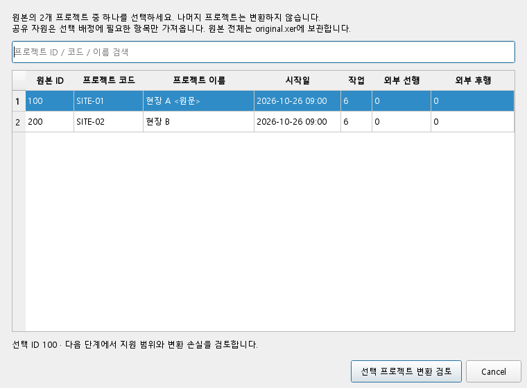
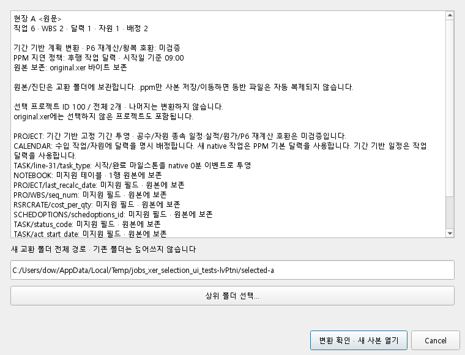

# 다중 프로젝트 XER 선택 로컬 검증

> 당시 원시 자료·화면·로그는 [고정 원본](https://github.com/jhoon-dev/ProjectPlanningManager/tree/77bb5a1cead1cb2c47f36e57b00d478746f32434/docs/validation/xer-project-selection-2026-11-03)에 보존되어 있습니다. 새 실행 결과는 CI 산출물로 보관합니다.

2026-11-03 [GAP-09 첫 증분 계약](../../xer-project-selection.md)의 Windows Release / Qt 6.8.3 / MinGW GCC 13.1.0 결과다. **전체 CTest 79개 통과, 실패 0개, 247.21초**다. [전체 로그](https://github.com/jhoon-dev/ProjectPlanningManager/blob/77bb5a1cead1cb2c47f36e57b00d478746f32434/docs/validation/xer-project-selection-2026-11-03/full-ctest.log), [시험별 출력](https://github.com/jhoon-dev/ProjectPlanningManager/blob/77bb5a1cead1cb2c47f36e57b00d478746f32434/docs/validation/xer-project-selection-2026-11-03/ctest-details.log), [제품 빌드](https://github.com/jhoon-dev/ProjectPlanningManager/blob/77bb5a1cead1cb2c47f36e57b00d478746f32434/docs/validation/xer-project-selection-2026-11-03/build.log)를 보존한다.

| 검사 | 결과 |
|---|---|
| 선택/고립 | 두 프로젝트 각 6작업·2 WBS. A는 자원 1/달력 1, B는 공유/개별 자원 2·전역 부모/프로젝트 달력 2. 미배정 자원·불필요 달력 제외 |
| 독립 날짜 | A 첫 8h 작업은 2026-10-26 18:00, B 첫 2h 작업은 같은 날 11:00 완료. 전체 native 계산 Valid 확인 |
| 차단/한도 | 입력 전체 ID 중복·프로젝트 소유·선택 WBS/내부 관계/배정 참조, missing resource/calendar/parent·calendar cycle·다른 프로젝트 소유 달력 차단. 전체 파일 16 MiB/작업 10,000 한도 유지 |
| 외부 관계 | 파일 내부/미포함 프로젝트의 incoming/outgoing 건수, 양 방향 모두 거절. 관계를 제거하거나 native 제약으로 대체하지 않음 |
| 의미 격리 | 비선택 LOE/자재 자원/잘못된 달력과 사용하지 않는 달력은 선택 투영에 섞지 않음. 필요한 미지원 항목은 거절 |
| 원본/게시 | 동일 바이트 한 번 읽기, 전체 원본/해시·선택/제외 행·원본 ID 매핑. 새 UUID·native 재열기/원자 게시·기존 대상 보존 |
| 화면/세션 | 첫 행 자동 선택 없음, ID/코드/이름 검색·원본 ID 유지, 외부 관계 차단/설명·좁은 창 건수 열 표시. 선택/미리보기 취소, 편집 revision/같은 ID 재열기 session, 디스크 파일 교체 시 보호 |
| 취소 | 사전 취소와 실제 worker 처리 중 inventory 취소. 기존 일반 교환/게시 취소 회귀도 함께 실행 |
| 품질 | 포맷 117 C++ 파일 변경 없음, 소스/빌드 해시 일치. 독립 reader와 기존 출력 검사 기록은 아래 참조 |

[core 계약](https://github.com/jhoon-dev/ProjectPlanningManager/blob/77bb5a1cead1cb2c47f36e57b00d478746f32434/docs/validation/xer-project-selection-2026-11-03/contract.json), [UI 계약](https://github.com/jhoon-dev/ProjectPlanningManager/blob/77bb5a1cead1cb2c47f36e57b00d478746f32434/docs/validation/xer-project-selection-2026-11-03/ui-contract.json), [A 선택/제외 보고](https://github.com/jhoon-dev/ProjectPlanningManager/blob/77bb5a1cead1cb2c47f36e57b00d478746f32434/docs/validation/xer-project-selection-2026-11-03/selected-a.json), [B 선택/제외 보고](https://github.com/jhoon-dev/ProjectPlanningManager/blob/77bb5a1cead1cb2c47f36e57b00d478746f32434/docs/validation/xer-project-selection-2026-11-03/selected-b.json), [순수 worker 측정](https://github.com/jhoon-dev/ProjectPlanningManager/blob/77bb5a1cead1cb2c47f36e57b00d478746f32434/docs/validation/xer-project-selection-2026-11-03/core-metrics.json), [포맷](https://github.com/jhoon-dev/ProjectPlanningManager/blob/77bb5a1cead1cb2c47f36e57b00d478746f32434/docs/validation/xer-project-selection-2026-11-03/format-check.json), [소스 식별](https://github.com/jhoon-dev/ProjectPlanningManager/blob/77bb5a1cead1cb2c47f36e57b00d478746f32434/docs/validation/xer-project-selection-2026-11-03/source-identity.json), [시험/fixture/검증 스크립트 해시](https://github.com/jhoon-dev/ProjectPlanningManager/blob/77bb5a1cead1cb2c47f36e57b00d478746f32434/docs/validation/xer-project-selection-2026-11-03/test-script-sha256.json), [문서 링크](https://github.com/jhoon-dev/ProjectPlanningManager/blob/77bb5a1cead1cb2c47f36e57b00d478746f32434/docs/validation/xer-project-selection-2026-11-03/markdown-links.json), [기계 판독 기록](https://github.com/jhoon-dev/ProjectPlanningManager/blob/77bb5a1cead1cb2c47f36e57b00d478746f32434/docs/validation/xer-project-selection-2026-11-03/verification.json)을 보존한다. 소스 SHA-256은 `62bf2a9e5fcdfd3d9b5f7cc5c5b8b566fef5a55caac153a905accef72ebe362b`이며 빌드 값과 일치한다. case-sensitive 정렬된 src cpp/h·CMakeLists.txt 레시피는 tests/mm/scripts/CI를 제외하므로 별도 해시를 남긴다. 기존 검증 폴더는 수정하지 않았다.

## 독립 reader와 범위

[TSV/MPXJ 결과](https://github.com/jhoon-dev/ProjectPlanningManager/blob/77bb5a1cead1cb2c47f36e57b00d478746f32434/docs/validation/xer-project-selection-2026-11-03/independent-selection.json)는 입력 두 PROJECT 목록·선택 ID/이름/직접 관계/배정과 native 계획 투영의 재수출 기간·자원, 전체 입력 SHA-256·선택/제외 행을 대조한다. Python 3.12.10 / MPXJ 16.10.0 / JPype1 1.6.0 / Temurin Java 21.0.11이며 [설치 로그](https://github.com/jhoon-dev/ProjectPlanningManager/blob/77bb5a1cead1cb2c47f36e57b00d478746f32434/docs/validation/xer-project-selection-2026-11-03/reader-dependencies.log)와 [버전](https://github.com/jhoon-dev/ProjectPlanningManager/blob/77bb5a1cead1cb2c47f36e57b00d478746f32434/docs/validation/xer-project-selection-2026-11-03/reader-versions.log)을 보존한다. `listProjects`는 UTF-8 BOM을 명시 처리하고 선택 원본/재수출 읽기는 UniversalProjectReader proxy의 BOM 처리를 사용한다. 원본 바이트는 변경하지 않는다.

원본은 실제 시작/status 필드도 포함하는 수작업 fixture다. native 가져오기는 target 기간 기반 계획 투영이다. MPXJ의 원본 실적 기간 산정이나 글로벌 자원 집합과 동일한 모델이라는 주장을 하지 않는다. 원본의 ID/이름/관계/배정과 계획 투영 출력의 기간을 구분해 검사한다. strict reader 성공은 P6 설치본의 수용·재계산/재저장 왕복을 대신하지 않는다.

독립 검증 9종이 모두 통과했다: 위 선택 reader, [기존 XER TSV/MPXJ](https://github.com/jhoon-dev/ProjectPlanningManager/blob/77bb5a1cead1cb2c47f36e57b00d478746f32434/docs/validation/xer-project-selection-2026-11-03/independent-legacy-xer.log), [일정 인쇄](https://github.com/jhoon-dev/ProjectPlanningManager/blob/77bb5a1cead1cb2c47f36e57b00d478746f32434/docs/validation/xer-project-selection-2026-11-03/independent-schedule-print.json), [평준화](https://github.com/jhoon-dev/ProjectPlanningManager/blob/77bb5a1cead1cb2c47f36e57b00d478746f32434/docs/validation/xer-project-selection-2026-11-03/independent-leveling-selection-exports.json), [일반 보고서](https://github.com/jhoon-dev/ProjectPlanningManager/blob/77bb5a1cead1cb2c47f36e57b00d478746f32434/docs/validation/xer-project-selection-2026-11-03/independent-report-exports.log), [Usage](https://github.com/jhoon-dev/ProjectPlanningManager/blob/77bb5a1cead1cb2c47f36e57b00d478746f32434/docs/validation/xer-project-selection-2026-11-03/independent-usage-exports.json), [분류](https://github.com/jhoon-dev/ProjectPlanningManager/blob/77bb5a1cead1cb2c47f36e57b00d478746f32434/docs/validation/xer-project-selection-2026-11-03/independent-classification-exports.json), [예측 여유](https://github.com/jhoon-dev/ProjectPlanningManager/blob/77bb5a1cead1cb2c47f36e57b00d478746f32434/docs/validation/xer-project-selection-2026-11-03/independent-forecast-float-exports.json), [기간 실적](https://github.com/jhoon-dev/ProjectPlanningManager/blob/77bb5a1cead1cb2c47f36e57b00d478746f32434/docs/validation/xer-project-selection-2026-11-03/independent-period-actual-exports.json). 파서 seed replay는 schema 1~12의 92개를 통과했다.

## 규모 관측

두 PROJECT에 작업을 반씩 둔 FS0·작업별 1h 체인, 배정 없음이다. 시작은 2026-10-26, 지원 기본/상속 달력과 작은 원본 부가 테이블을 유지한다. 순수 worker에서 전체 구조/ID 목록 작성 후 동일 바이트를 다시 parse하여 B를 선택·검증한다. UI ready/heartbeat/실제 데스크톱 시간이나 모든 관계 밀도의 상한은 측정하지 않았다. 한 번의 로컬 표본이며 OS 캐시/순서를 통제한 성능 보장이 아니다.

| 입력 작업 | 선택 작업 | 바이트 | 목록 ms | 선택 가져오기 ms |
|---|---|---|---|---|
| 1,000 | 500 | 118,911 | 13.28 | 62.49 |
| 10,000 | 5,000 | 1,180,911 | 89.03 | 227.67 |

## 화면

## 재현/미실행

`ctest --test-dir build-forecast -R 'xer_project_selection|primavera_xer|parser_seed_replay' --output-on-failure`, `.deps/xer-reader-verification/Scripts/python.exe scripts/verify-xer-project-selection.py build-forecast`로 실행한다. 검증에만 Java/Python reader를 사용하며 앱 실행에는 필요 없다. CI에는 새 reader 검사와 산출물 업로드를 추가했으나 이 세션에서 CI를 실행하지 않았다.

실제 데스크톱/접근성 조작, macOS/Linux, 새 coverage-guided fuzz, ASan/UBSan·clang-tidy, 실제 P6/MSP, 패키징/설치/서명은 미실행이다. native schema 1~12 해석과 조건부 9/10/11/12 쓰기를 유지한다. MPP, 일괄 작업공간 생성·프로젝트 병합/링크, 다중 프로젝트 내보내기, 실적/원가/기준선 매핑은 후속이다.
